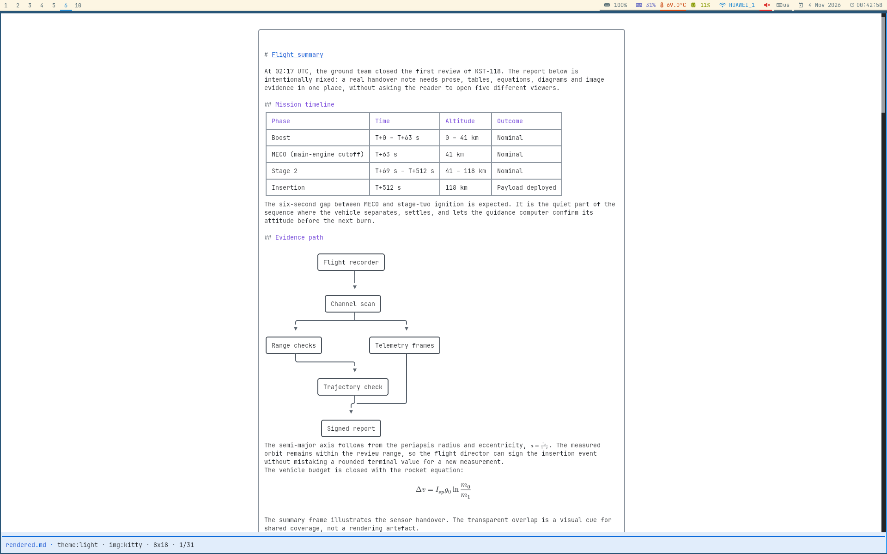
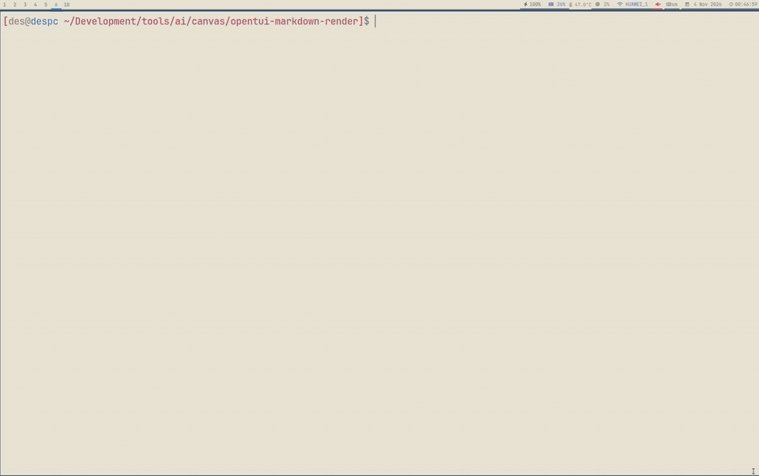
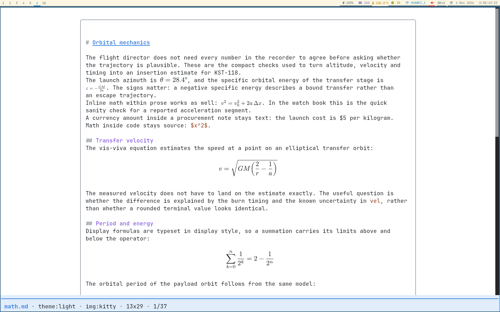
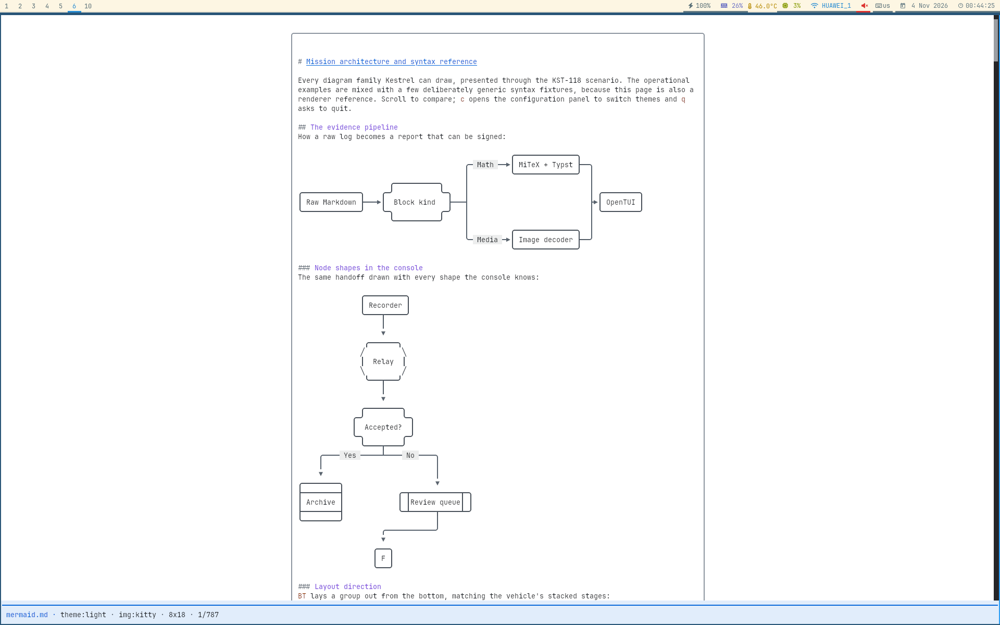
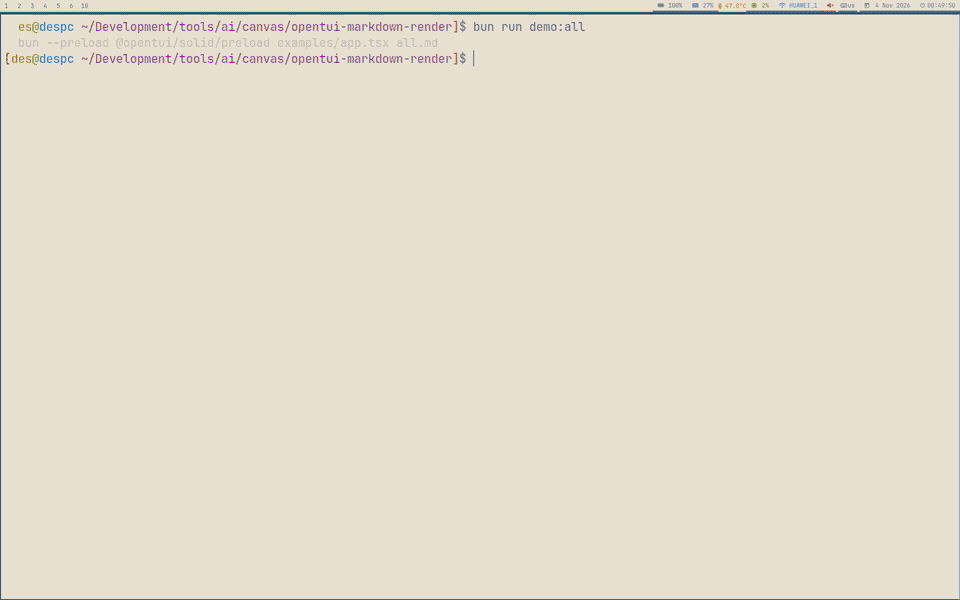

# OpenTUI Markdown Render

[](https://github.com/Desiment/opentui-markdown-render/actions/workflows/verify.yml)

`opentui-markdown-render` is a Markdown renderer for [OpenTUI](https://github.com/anomalyco/opentui) and Solid. It turns Markdown into a terminal-native document with tables, syntax-highlighted code, Mermaid diagrams, local images, animated GIFs, and optional LaTeX-style mathematics.



## Why this renderer exists

Terminal UIs usually have to choose between displaying Markdown as plain text and embedding a web renderer that does not understand terminal layout. This package keeps the document in the OpenTUI layout model instead:

- paragraphs, headings, lists, quotes, links, emphasis, code, rules, and task lists;
- inline and display math, rendered in-process with terminal image protocols (Kitty gives the sharpest output);
- Mermaid flowcharts, sequence diagrams, state diagrams, Gantt charts, timelines, Git graphs, and class diagrams;
- content-sized tables with optional horizontal scrolling;
- local PNG, JPEG, WebP, and animated GIF assets;
- configurable themes, heading styles, frames, status lines, image limits, and Mermaid layout;
- a parser-only `core` entry point for hosts that need their own view or document pipeline;
- source ranges and render units for selection, comments, review tools, and overlays owned by the host.

The renderer uses OpenTUI primitives rather than OpenTUI's built-in Markdown parser. Math is rasterized by the native addon using MiTeX and Typst; the renderer does not start a system LaTeX or Typst process.

## See it in action

### Live themes and configuration

Press `c` in the demo to switch between light, dark, and Solarized themes and to adjust frame, table, and class-diagram layout without restarting the viewer.



### Typeset mathematics

Inline formulas participate in normal text layout, while display formulas use display style with large operators and limits. Rendering happens in-process through MiTeX and Typst.



### Terminal-native Mermaid diagrams

Supported Mermaid families are parsed and laid out as terminal diagrams rather than browser SVG. Unsupported syntax remains a readable source fence.



### Local images and animated GIFs

Local assets are decoded below the configured asset root, fitted to terminal cells, and composited against the active background. GIF timing and transparency are retained.



## Quick start

### Try the standalone demo

The repository contains a viewer and focused Markdown fixtures. The demo needs Bun, and the native math addon needs a Rust toolchain when building locally.

```sh
bun install
bun run generate:examples
bun run build:native
bun run demo:all
```

The demo accepts a fixture name as a command-line argument:

```sh
bun run demo:plain
bun run demo:math
bun run demo:mermaid
bun run demo:images
bun run demo:frame
```

Press `c` to open the configuration panel. Use Up/Down (or `j`/`k`) to select an option and Left/Right (or `h`/`l`) to change it. Press `q` to open the exit confirmation. The demo's runtime changes are not written to the JSONC file.

See [Examples and demo fixtures](examples/README.md) for the complete fixture matrix and [Getting started](docs/getting-started.md) for a step-by-step walkthrough.

### Install in an OpenTUI application

```sh
bun add opentui-markdown-render @opentui/core @opentui/solid solid-js
```

`@opentui/core`, `@opentui/solid`, and `solid-js` are peer dependencies. The package currently targets Bun 1.4+, OpenTUI 0.5.12+, and Solid 1.9+. Native prebuild coverage is currently Linux x64 with glibc.

The smallest useful component looks like this:

```tsx
import { createCliRenderer } from "@opentui/core"
import { render } from "@opentui/solid"
import { MarkdownRenderer } from "opentui-markdown-render"

const renderer = await createCliRenderer({})

render(
  () => (
    <MarkdownRenderer
      content={() => "# Hello\n\nProbability is $P(A \\mid B)$."}
      renderer={renderer}
    />
  ),
  renderer,
)
```

`content` and `document` are reactive accessors. Pass exactly one of them. Use `content` when the renderer should parse Markdown itself, or pass a `parseDocument` result when the host already owns parsing or caching:

```tsx
import { MarkdownRenderer, parseDocument } from "opentui-markdown-render"

const document = parseDocument(markdown)

<MarkdownRenderer
  document={() => document}
  renderer={renderer}
/>
```

The component measures the area assigned by its parent. Put it inside an OpenTUI `scrollbox` when the host owns vertical scrolling, and use `assetBase` for local images.

## What the output supports

| Input | Terminal output |
| --- | --- |
| Markdown headings and emphasis | Styled text with per-level colour, attributes, and spacing |
| Fenced code | OpenTUI code blocks with language-aware highlighting where supported |
| Tables | Content-sized terminal tables; wide tables can pan horizontally |
| `$inline$`, `$$display$$`, `\(inline\)`, `\[display\]` | In-process math images; quality depends on the terminal image protocol |
| Mermaid fences | Native terminal diagrams for the supported diagram families |
| Local PNG/JPEG/WebP/GIF | Terminal images with size limits and GIF frame timing |
| Links | Labels retain their `href`; terminals without hyperlinks show the target as text |
| Unsupported content | A readable source-oriented fallback rather than a silently missing block |

The renderer is deliberately not a browser. HTML is displayed literally, network image URLs are rejected, and unsupported Mermaid syntax remains a code fence. See [Features and supported Markdown](docs/features.md), [Mermaid support](docs/MERMAID_SUPPORT.md), and [Fallbacks and limitations](docs/features.md#fallbacks-and-limitations).

## Documentation

Start with the page that matches the task:

- [Documentation index](docs/README.md) — all guides and reference pages.
- [Getting started](docs/getting-started.md) — installation, demo setup, first integration, and host layout.
- [Configuration](docs/CONFIGURATION.md) — JSON/JSONC discovery, themes, frames, tables, headings, images, Mermaid, and status lines.
- [API reference](docs/api.md) — public exports, component props, document types, helpers, and host-owned state.
- [Integration recipes](docs/recipes.md) — streaming, cached documents, themes, status lines, frames, and overlays.
- [Features and supported Markdown](docs/features.md) — rendering behaviour, math, images, tables, links, source preservation, and fallbacks.
- [Mermaid support matrix](docs/MERMAID_SUPPORT.md) — rendered, ignored, approximated, and unsupported syntax by family.
- [Troubleshooting](docs/troubleshooting.md) — work through common native, terminal, image, config, and layout problems.
- [Architecture](docs/architecture.md) — parser, layout, view, native math, media, and host boundaries.
- [Development](docs/development.md) — verification, native builds, fixtures, tests, and documentation captures.
- [Examples](examples/README.md) — runnable fixtures that act as executable documentation.

## Important constraints

- The release target is currently Linux x64 with glibc. Other platforms can still render text and leave formula source readable when a native prebuild is unavailable.
- Kitty graphics gives the best math quality; the image pipeline also supports Sixel and block-character output when available. Missing native math or failed conversion leaves the original LaTeX source readable.
- The native addon is in-process Rust code containing MiTeX, Typst, embedded fonts, and PNG rasterization. It does not invoke system LaTeX, TeX Live, Typst, or an external rasterizer.
- Local images are resolved below `assetBase`; network URLs and paths that escape that root are refused.
- Mermaid support is an intentional subset of Mermaid, not a compatibility claim for the full upstream grammar.
- The library does not own selection, comments, persistent IDs, or scrolling state. Hosts use `renderUnit`, source ranges, and their own state for those features.

## Development

```sh
bun install
bun run verify
```

`verify` builds the native addon, runs TypeScript type checking, runs the Bun test suite, and runs the Rust tests. See [Development](docs/development.md) before changing parser behaviour, native math, fixtures, or documentation captures.

## License

The project is released under the [MIT License](LICENSE). The native math pipeline includes MiTeX; its notice is included in [`NOTICE`](NOTICE).
