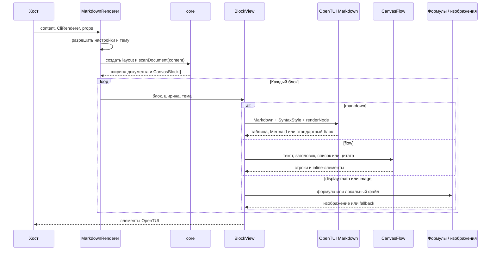
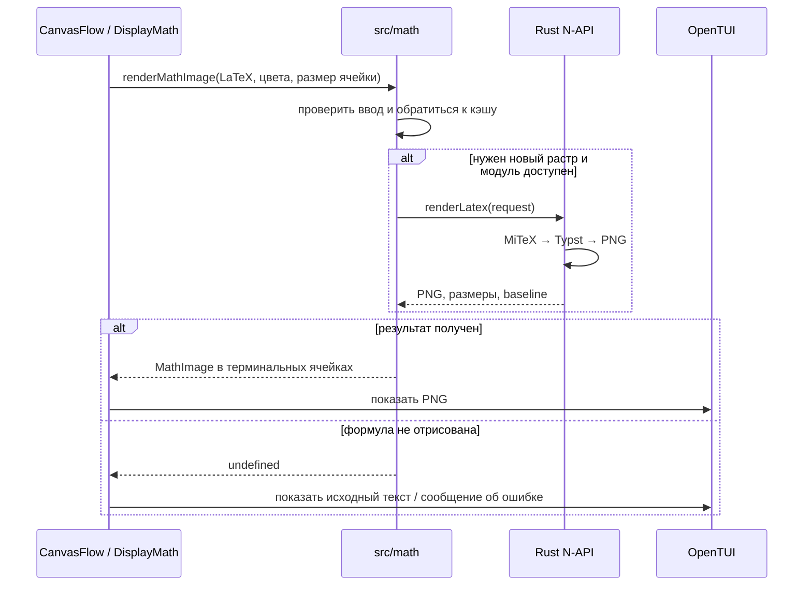
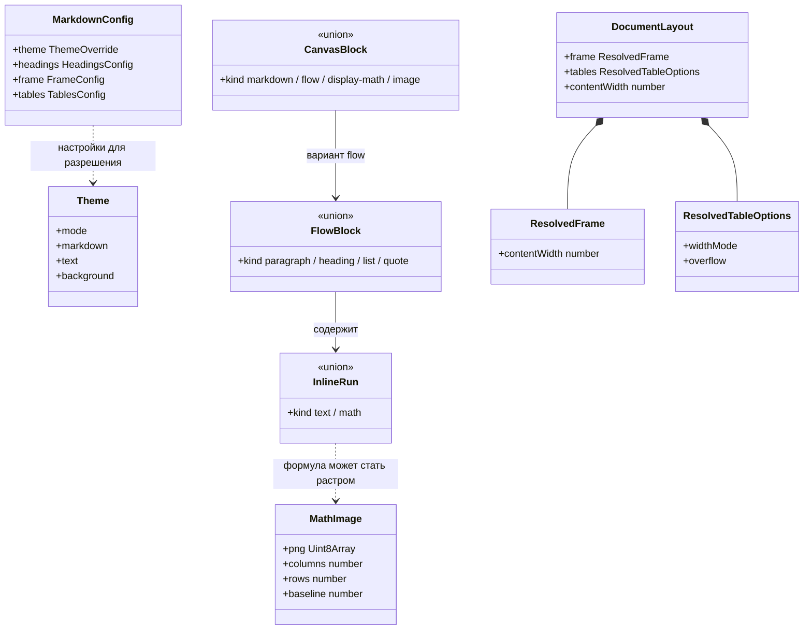

# Архитектура opentui-markdown-render

`opentui-markdown-render` — встраиваемая библиотека для отображения Markdown в терминале через OpenTUI и Solid. Приложение-хост создаёт `CliRenderer`, передаёт содержимое в `MarkdownRenderer` и само размещает его в интерфейсе. Например, прокрутка документа и `StatusLine` принадлежат хосту, а не компоненту рендеринга.

## Слои

| Слой | Код | Ответственность |
| --- | --- | --- |
| Чистое ядро | `src/core/` | Разбиение Markdown на блоки, разбор inline-содержимого, расчёт ширины фрейма и параметров таблиц; не зависит от Solid и OpenTUI. |
| Оркестрация | `src/app.tsx` | Получение настроек и темы, измерение ширины, реактивное построение блоков, выбор способа отображения. |
| Отображение | `src/inline.tsx`, `src/view/`, `src/theme/` | Собственная раскладка текста и inline-формул, блочная математика, визуальная оболочка, таблицы и правила подсветки OpenTUI. |
| Специализированные возможности | `src/math/`, `native/`, `src/media.tsx`, `src/merman/` | Формулы, локальные изображения и Mermaid-диаграммы. |

Точка входа пакета — `src/index.ts`. Отдельный экспорт `./core` (`src/core/index.ts`) позволяет использовать разбор и расчёты без UI.

## Рендеринг документа

`scanDocument()` возвращает блоки четырёх видов: `markdown`, `flow`, `display-math` и `image`. Библиотека не строит единый AST для всего Markdown. Для текста, который она уверенно распознаёт, используется собственный `CanvasFlow`; оставшиеся Markdown-блоки передаются рендереру OpenTUI. В частности, таблицы и Mermaid обрабатываются через его механизм `renderNode`.

`createDocumentLayout()` вычисляет ширину содержимого с учётом фрейма. Эта ширина используется всеми ветками отображения, чтобы текст, таблицы и формулы не расходились по правому краю. `src/graphics.ts` наблюдает за возможностями терминала и размером ячейки: эти данные влияют на размер растров и выбор протокола изображения (`kitty`, `sixel` или символьная мозаика).

### Что происходит в отдельных ветках

- **Markdown/OpenTUI:** `generateSyntax()` превращает тему и стили заголовков в правила подсветки; `src/view/markdown-style.ts` окрашивает блоки, которые OpenTUI рисует не как обычный текст (например, разделитель и маркеры списка); таблицы настраиваются в `src/view/table.ts`, Mermaid-блоки — в `src/merman/markdown.ts`. Если специализированный обработчик не подходит, OpenTUI рисует блок обычным способом.
- **Flow:** `src/inline.tsx` самостоятельно размещает текстовые фрагменты и inline-формулы, учитывая переносы, базовую линию и стили заголовков. Поэтому правила оформления текста могут требовать согласованного применения и здесь, и в ветке OpenTUI.
- **Изображения:** `src/media.tsx` допускает локальные пути в пределах предоставленной хостом директории ресурсов, подгоняет изображение под ограничения терминала и поддерживает GIF.
- **Mermaid:** `src/merman/` определяет вид диаграммы, разбирает её, строит сетку терминальных символов и окрашивает её на основе темы. При неподходящем или недостроенном блоке возможен возврат к отображению исходного кода.

## Формулы

Inline-формулы входят в раскладку `CanvasFlow`, а блочные формулы отображаются компонентом `DisplayMath` из `src/view/math.tsx`. Обе ветки используют общий путь растеризации. Результат зависит не только от LaTeX, но и от цвета, фона и размера ячейки терминала; внутренний масштаб пикселей не является пользовательской настройкой.

Нативный модуль загружается по требованию из `prebuilds/linux-x64-gnu` на Linux x64; другие платформы или отсутствие модуля приводят к fallback. `src/math/renderer.ts` кэширует запросы к нему, а Rust-код в `native/src/lib.rs` выполняет преобразование и растеризацию в процессе, без запуска системного LaTeX или Typst.

## Основные типы и связи

На диаграмме показаны **типы данных**, а не классы компонентов: `MarkdownRenderer` и `CanvasFlow` — функции Solid. Стрелки отражают состав или использование типов; наследование здесь не подразумевается.

`MarkdownConfig` задаёт частичные настройки; итоговая `Theme` и `DocumentLayout` рассчитываются отдельно. `CanvasBlock` определяет маршрут отображения, а `FlowBlock` описывает текстовые конструкции внутри маршрута `flow`. Связь `InlineRun` с `MathImage` обозначает результат обработки формулы, а не поле типа.

## Граница ответственности хоста

Хост управляет жизненным циклом `CliRenderer`, содержимым документа, доступной областью и прокруткой, а также передаёт путь к локальным ресурсам. Он может передать готовую тему или конфиг. `StatusLine` — отдельный экспорт: библиотека предоставляет её отрисовку, но хост сам решает, показывать ли строку состояния и какие значения в неё передать. Пример интеграции находится в `examples/app.tsx`.

### Интеграция с OpenCode V2 (проверить перед внедрением)

Согласно [документации TUI-плагинов OpenCode V2](https://opencode.ai/v2/docs/build/plugins/cli), плагин получает `context.renderer` и тему, а JSX можно размещать в slots, маршрутах и панелях. Для fenced code blocks есть отдельная регистрация обработчика. Документация **не обещает замены штатного рендерера всего Markdown**: если нужно заменить отображение сообщений сессии, сначала требуется подтвердить подходящую точку интеграции, не опираясь на приватное дерево OpenTUI.

Текущая библиотека рассчитана на OpenTUI 0.5.12. В OpenTUI 0.6 ресурсы `SyntaxStyle` требуют владельца (`renderer.nativeScene`) и корректного уничтожения после последнего кадра. Перед поддержкой плагина необходимо проверить совместимость этого жизненного цикла и адаптацию темы OpenCode на реально установленной версии, а не считать перенос компонентов автоматически безопасным.
