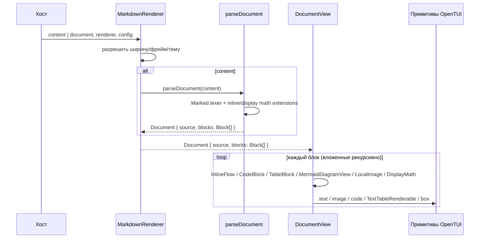

# Архитектура opentui-markdown-render

`opentui-markdown-render` — встраиваемая библиотека для отображения Markdown в терминале через OpenTUI и Solid. Хост создаёт `CliRenderer`, передаёт содержимое в `MarkdownRenderer` и сам управляет прокруткой и `StatusLine`.

## Слои

| Слой | Код | Ответственность |
| --- | --- | --- |
| Чистое ядро | `src/core/parse.ts`, `src/core/math.ts`, `src/core/document.ts`, `src/core/{frame,layout,tables,image}.ts` | Один вызов `Marked.lexer` с локальными math-расширениями; AST-lite, source ranges и параметры layout. Не импортирует OpenTUI или Solid. |
| Оркестрация | `src/app.tsx` | Разрешение конфигурации/темы, измерение доступной ширины и передача документа в `DocumentView`. Наличие формулы не меняет путь рендеринга. |
| Отображение | `src/view/document.tsx`, `src/view/inline-{style,layout,math,flow}.*`, `src/view/{document-table,code,mermaid,math,frame}.tsx` | Рекурсивное отображение блоков, единая раскладка текста и формул, таблицы, код и диаграммы на низкоуровневых примитивах OpenTUI. |
| Специализированные возможности | `src/math/`, `native/`, `src/media.tsx`, `src/merman/` | Растеризация TeX, локальные изображения и разбор Mermaid. |

`./core` экспортирует парсер и модель без UI. `src/index.ts` экспортирует их вместе с `MarkdownRenderer` и самостоятельными хостовыми helpers.

## Поток данных

`MarkdownRenderer` принимает ровно один вход: `content: () => string` или готовый `document: () => Document`. Готовый документ пропускает `parseDocument` и используется как есть; остальные props, тема и фрейм работают одинаково.

Парсер сохраняет `Document.source`, `raw` блоков, ссылочные `href` и исходные разделители формул. Точный `SourceRange` даётся там, где исходный текст совпадает с последовательными токенами Marked; для нормализованных вложенных блоков стоит `null`. Верхнеуровневый `ListItem` получает `source`, только если его `raw` точно совпадает с очередным срезом `list.raw`; хвостовой перевод строки может остаться вне последнего пункта. Это временная модель для текущего текста, а не persistent ID или review-модель. Незакрытые формулы остаются исходным текстом; специального сигнала о границе незакрытой формулы нет.

Опциональный `renderUnit` оборачивает не перекрывающиеся единицы документа. Вне верхнеуровневого списка единица — каждый верхнеуровневый блок, кроме самого списка; внутри верхнеуровневого списка единица — весь пункт целиком, включая вложенные списки, таблицы, изображения и формулы. Дети пункта отдельных единиц не образуют. `UnitInfo` содержит либо `block` (тип `Block` без `list`), либо `item`, и `source: SourceRange | null`; при `null` единица всё равно рисуется и передаётся в обёртку. Без `renderUnit` возвращается исходный `content` без дополнительной обёртки. Хост сам хранит выделение, комментарии и постоянные идентификаторы.

`DocumentView` сопоставляет блоки по префиксу/суффиксу и однозначной правке в середине. Слот сохраняет идентичность, но обновляет `block`, если изменились поля AST или `source`; это важно, например, когда меняется только ссылочное определение, а `raw` абзаца остаётся прежним. Однозначная правка Mermaid сохраняет локальный last-good. Это не общий diff AST. Внутри `InlineFlow` обычный текст и `$...$` проходят через одну раскладку; формула может быть растровой, а в неподдерживаемой среде остаётся исходным текстом. У `DisplayMath` отдельный компонент, использующий тот же `renderMathImage` и нативный растр MiTeX → Typst → PNG. Цвет, фон и размер ячейки входят в ключ ресурса; внутренний масштаб не является настройкой хоста.

Для таблиц `TextTableRenderable` создаётся через публичное расширение Solid `extend`; нестандартный prop `tableData` нужен потому, что reconciler Solid приводит любой prop с именем `content` к строке. Скроллер оставляет мышиное горизонтальное перемещение лишь для переполненного режима `content+scroll`; вертикальную прокрутку отдаёт хосту. `src/view/table.ts` содержит общий скроллер для таблиц, а `src/merman/diagram.ts` готовит диаграммы для `MermaidDiagramView`; адаптеров к OpenTUI `<markdown>` больше нет.

`src/graphics.ts` следит за возможностями терминала и размером ячейки: от них зависит размер растра и протокол изображения. Локальные изображения разрешаются под корнем ресурсов; URL/выход за корень не загружаются. `StatusLine` никак не зависит от парсера документа.

## Граница ответственности хоста

Хост управляет жизненным циклом `CliRenderer`, содержимым документа, доступной областью и прокруткой, а также передаёт путь к локальным ресурсам. Он может передать готовую тему или конфиг. `StatusLine` — отдельный экспорт: библиотека предоставляет её отрисовку, но хост сам решает, показывать ли строку состояния и какие значения в неё передать. Пример интеграции находится в `examples/app.tsx`.
### Интеграция с OpenCode V2 (проверить перед внедрением)

Согласно [документации TUI-плагинов OpenCode V2](https://opencode.ai/v2/docs/build/plugins/cli), плагин получает `context.renderer` и тему, а JSX можно размещать в slots, маршрутах и панелях. Для fenced code blocks есть отдельная регистрация обработчика. Документация **не обещает замены штатного рендерера всего Markdown**: если нужно заменить отображение сообщений сессии, сначала требуется подтвердить подходящую точку интеграции, не опираясь на приватное дерево OpenTUI.

Текущая библиотека рассчитана на OpenTUI 0.5.12. В OpenTUI 0.6 ресурсы `SyntaxStyle` требуют владельца (`renderer.nativeScene`) и корректного уничтожения после последнего кадра. Перед поддержкой плагина необходимо проверить совместимость этого жизненного цикла и адаптацию темы OpenCode на реально установленной версии, а не считать перенос компонентов автоматически безопасным.
