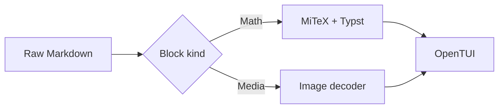
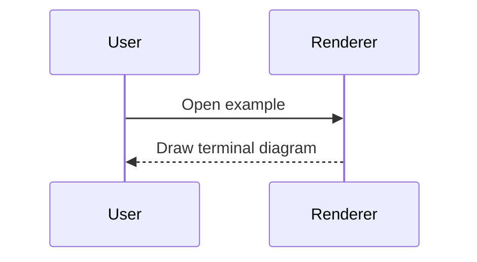
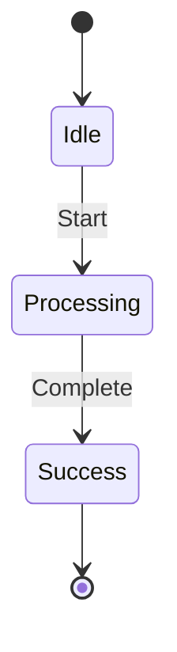
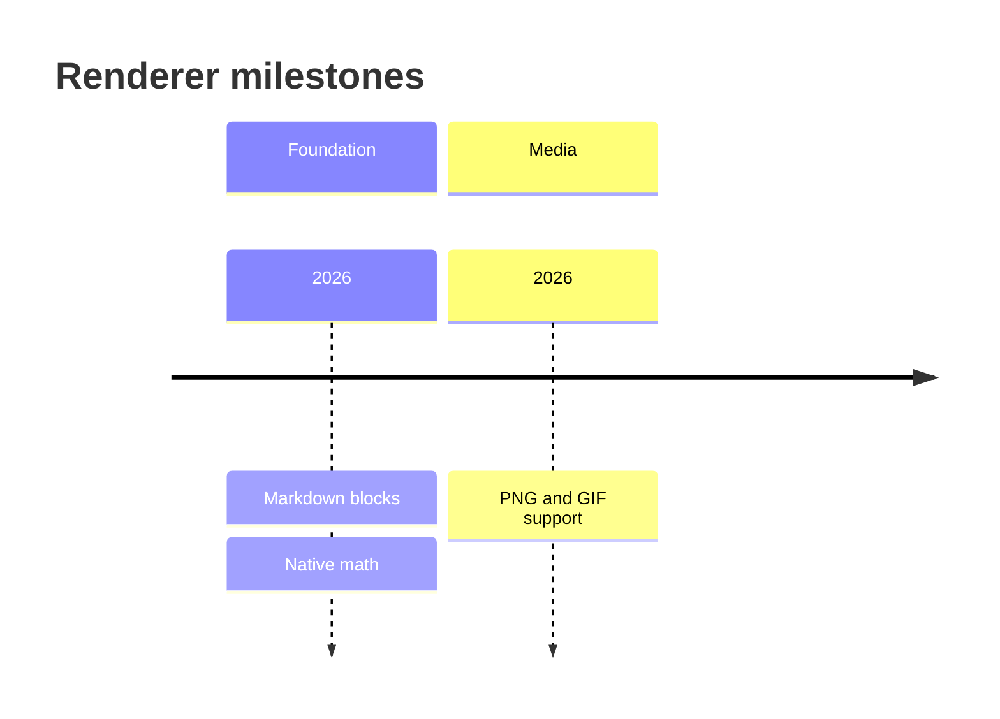
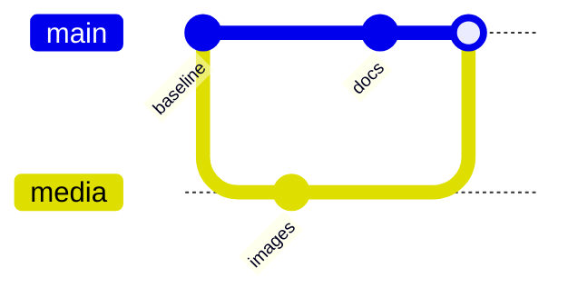
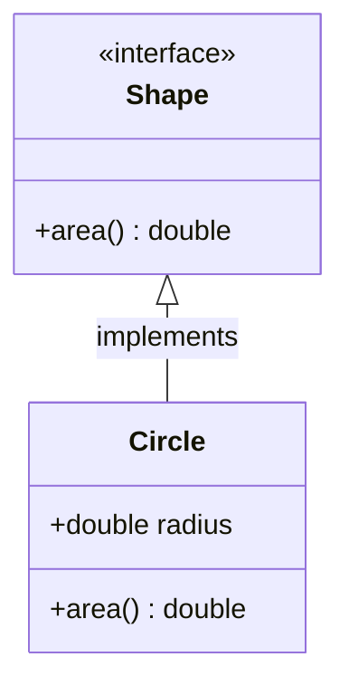

# Mermaid support

The renderer implements a terminal-oriented subset of Mermaid. It does not promise compatibility with the complete upstream Mermaid grammar or a particular Mermaid release.

Only fenced `mermaid` blocks whose first meaningful line identifies one of the seven families below are eligible for diagram rendering. The terminal theme controls colours; browser CSS and SVG-specific behaviour are not reproduced.

**Legend:** “rendered” affects the diagram; “accepted but ignored” keeps the block renderable but has no visual/semantic effect; “unsupported” normally leaves the source fence visible.

| Family / first line | Rendered | Accepted but ignored or approximated | Unsupported examples |
| --- | --- | --- | --- |
| `flowchart` / `graph` | `TB`, `TD`, `BT`, `LR`, `RL`; box, rounded, circle, decision, database, subroutine, hexagon, and parallelogram nodes; arrows, links, labels, chains, `&` groups, nested subgraphs, top-level `;` separators | `classDef`, `class`, `style`, `linkStyle`; terminal theme wins; `%%` comments | Modern `@{ shape: ... }`, `click`/hyperlinks, unknown statements and other node shapes |
| `sequenceDiagram` | Participants, aliases, boxes, messages, notes, activations, `autonumber`, `alt`/`else`, `loop`, `opt`, `par`/`and`, `critical`/`option`, `break` | Box colour is not applied; its label is retained; `%%` comments | `rect`, participant `create`/`destroy`, bidirectional messages |
| `stateDiagram` / `stateDiagram-v2` | Directions, transitions and labels, start/end, declarations/descriptions, choice, fork/join, composites, inline/multiline notes | `%%` comments | Direction inside a composite state and unknown state statements |
| `gantt` | `title`, `section`, `dateFormat`, fixed-unit `tickInterval`; task IDs, `after`, durations/end dates, `active`, `done`, `crit`, milestones; date formats `s`, `X`, `x`, `HH:mm`, `HH:mm:ss`, `YYYY-MM-DD`, `YYYY-MM-DD HH:mm`, `YYYY-MM-DD HH:mm:ss` and the equivalent ISO `T` date-time forms | `accTitle`, `accDescr`, `%%`; `vert` draws as a regular task | `excludes`, `todayMarker`, calendar-month ticks, other date formats |
| `timeline` | `title`, `section`, periods and colon-separated events, continuation lines | `accTitle`, `accDescr`, `%%`; `TD`/`LR` is parsed but layout remains vertical | Empty title/section, continuation without a period, unknown lines that cannot be interpreted |
| `gitGraph` | `commit` with ID/message/tags/type, `branch`, `checkout`/`switch`, `merge`, simple `cherry-pick id: "..."` | `title`, accessibility metadata, comments; `LR`/`TB`/`BT` is parsed but layout remains vertical | `cherry-pick` with `parent:` or extra options, unknown commands/attributes |
| `classDiagram` | Directions, classes, labels, members, stereotypes, relationships, cardinalities, and `note for Class "..."` inside the class box | Accessibility metadata and comments | Standalone notes, `namespace`, `package`, `click`/hyperlinks, CSS styles |

Other families such as `erDiagram`, `pie`, `journey`, `mindmap`, `sankey`, and `xychart` are not detected and remain readable code fences.

## Minimal working examples

Each block below is derived from a checked fixture in [`examples/mermaid.md`](../examples/mermaid.md). Copy a complete fenced block into a document to compare it with the renderer's fallback behaviour.

### Flowchart



Direction is part of the first line. A supported `graph` declaration works in place of `flowchart`. Styles defined with Mermaid CSS directives do not override the terminal palette.

### Sequence diagram



For branching and concurrent interactions, `alt`/`else`, `opt`, `loop`, `par`/`and`, and `critical`/`option` are supported. Browser-specific visual grouping such as `rect` is not.

### State diagram



The start/end markers and transition labels are rendered in the terminal grid. Composite states, forks, joins, choices, and notes are also covered by the fixture suite.

### Gantt chart

```mermaid
gantt
  title Build Pipeline
  dateFormat HH:mm
  tickInterval 1h
  section Core
  Scan :a1, 00:00, 2h
  Inline :after a1, 3h
```



Fixed-unit ticks work; calendar-month ticks, excluded days, and a today marker are not rendered. Check the date-format list in the matrix before assuming an upstream Gantt format works here.

### Timeline



Continuation lines beginning with `:` add events to the preceding period. The terminal timeline remains vertical even if a direction directive is parsed.

### Git graph



Branches and merges are rendered, but the terminal graph remains vertical regardless of a parsed direction. `cherry-pick id: "..."` supports the simple form, not additional parent options.

### Class diagram



`mermaid.classLayout` can switch between the terminal-optimized `builtin` layout and `dagre`. Only notes attached to a class are supported; standalone notes and namespaces remain unsupported.

## Configuration

```jsonc
{
  "mermaid": {
    "compact": false,
    "layoutMaxWidth": 120,
    "classLayout": "builtin"
  }
}
```

`classLayout` is specific to class diagrams. `builtin` is the terminal-optimized default; `dagre` uses Dagre's layered layout. `layoutMaxWidth` bounds diagram layout and `compact` requests a denser layout.

## Errors and editing behaviour

If a detected family's source contains an unsupported statement, parsing raises `MermaidSyntaxError`. The view normally shows the original source fence. While an existing diagram is being edited, the view may retain its last valid rendering or render a valid prefix until the new input is complete.

The drawing canvas is limited to 250,000 cells. A flowchart source line may contain at most 10,000 characters. Exceeding a limit does not produce a partial drawing.

## Fixtures and tests

The support contract is exercised by:

- [`examples/mermaid.md`](../examples/mermaid.md) — one broad family overview;
- [`examples/merman-ext.md`](../examples/merman-ext.md) — a larger stress suite;
- [`test/mermaid-support.test.ts`](../test/mermaid-support.test.ts) — support assertions;
- [`test/mermaid-extended.test.ts`](../test/mermaid-extended.test.ts), [`test/merman-ext.test.ts`](../test/merman-ext.test.ts), and Mermaid view render tests.
