# Kestrel documentation

Everything the renderer covers, in one page: prose, code, tables, formulas,
diagrams and telemetry frames.

## The tool

Kestrel turns a raw flight log into a readable terminal report. It parses
CommonMark, typesets the formulas, and draws the diagrams and frames that come
with the log.

### Formatting

Reports mix *italic*, **bold** and `inline code`, and a cross-reference such as
[the flight plan](https://github.com/sst/opentui) keeps its label.

### A note from the flight director

> Every figure in a report has to survive being read over SSH, on a terminal
> that cannot draw a single pixel. When a frame or a formula cannot be
> rendered, the source is printed instead of a broken image.

### The parts of a report

- Flight data
  - Altitude and velocity
  - Propellant mass
- Analysis
  - Formulas
  - Diagrams
1. Recording
2. Decoding
3. Reporting

---

## Code

```js
function greet(vehicle) {
  return `Hello, ${vehicle}!`
}
console.log(greet("Kestrel"))
```

## Tables

| Left | Center | Right |
|------|:------:|------:|
| A    | B      | C     |
| 1    | 2      | 3     |

## Math

Inline: $E = mc^2$, $x^2 + y^2 = r^2$, $\sqrt{x+1}$

Display:
$$
\int_0^\infty e^{-x}\,dx = 1
$$

Display style moves the limits of a large operator above and below it, and the
scope handles the commands Typst has no direct equivalent for:
$$
\sum_{k=0}^{n} \frac{1}{2^k} = 2 - \frac{1}{2^n}, \qquad \sqrt[3]{\frac{a}{b}}
$$

Truncated, and therefore left as source: $$\frac{1}{ $$

## Diagrams

### The pipeline, in both directions

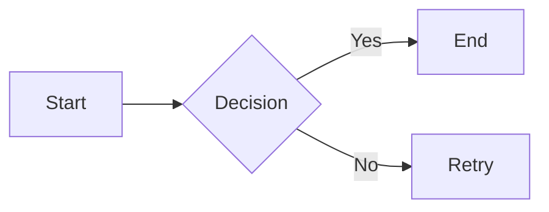

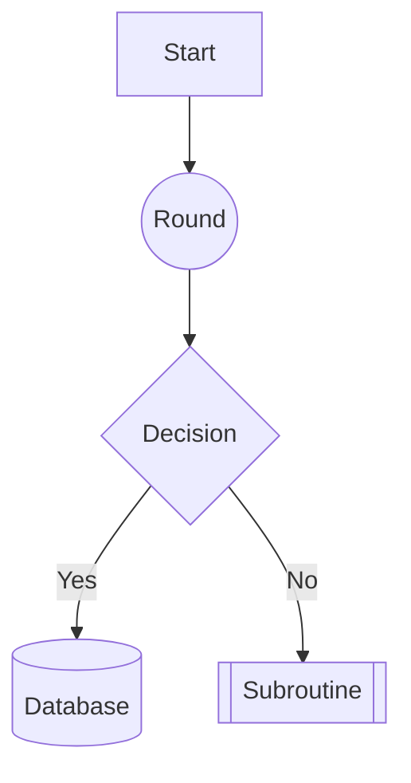

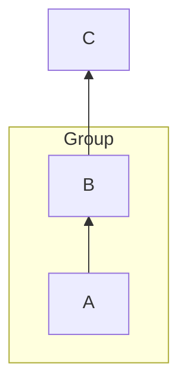

### The handoff

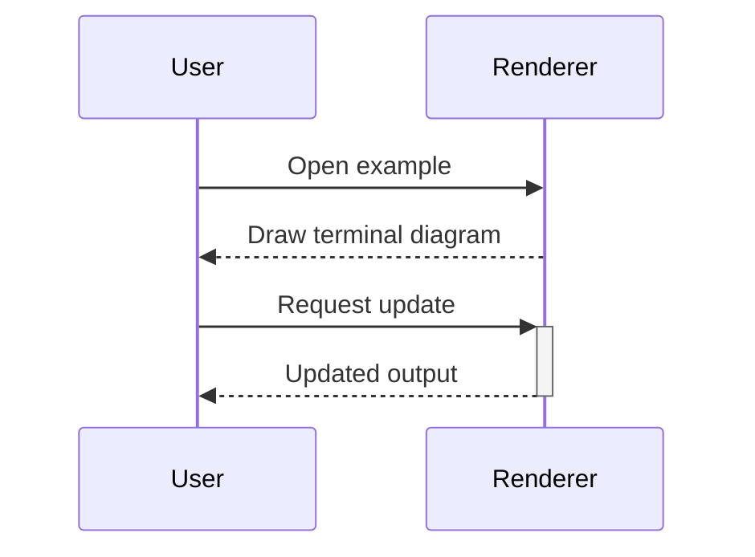

### Vehicle states

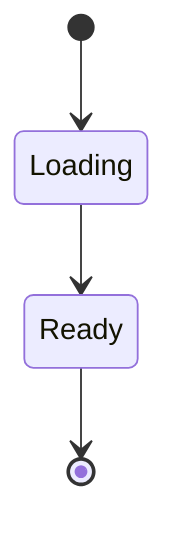

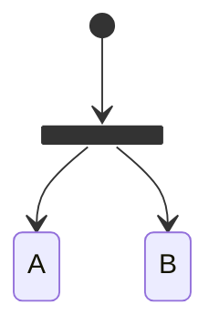

### The launch window

```mermaid
gantt
  dateFormat s
  section Render
  Parse Markdown :0, 2
  Typeset math :active, 2, 5
  Draw media :3, 7
```

### Milestones

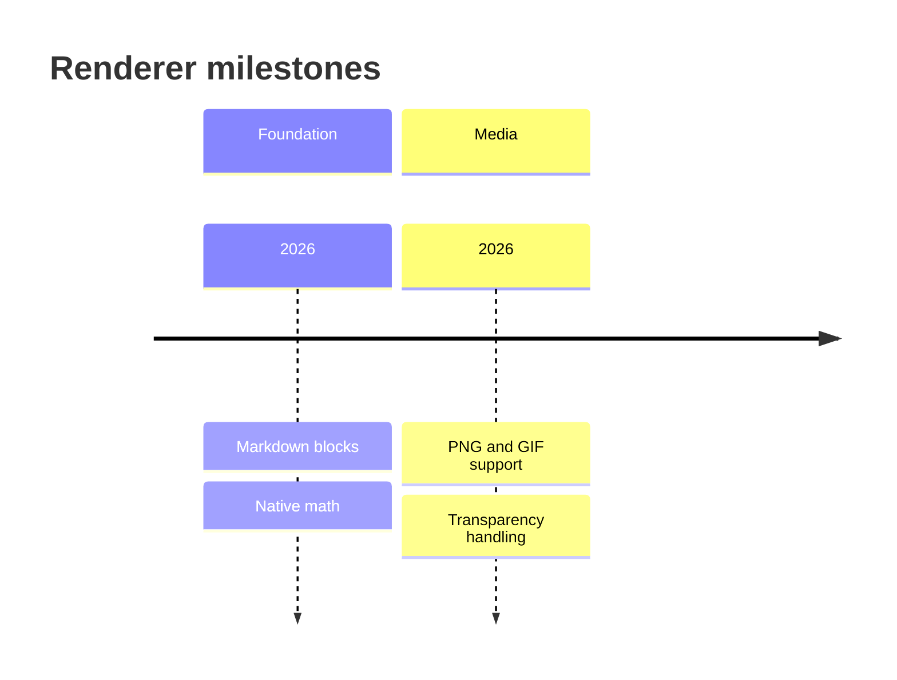

### Release history

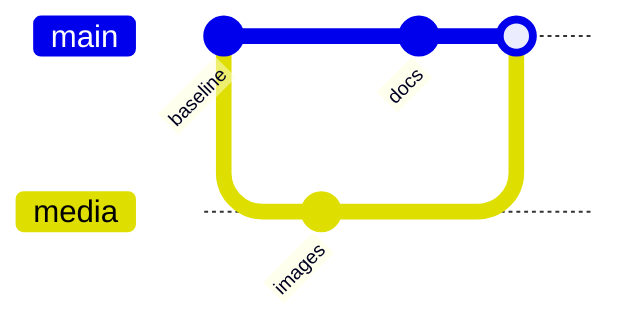

### The vehicle model

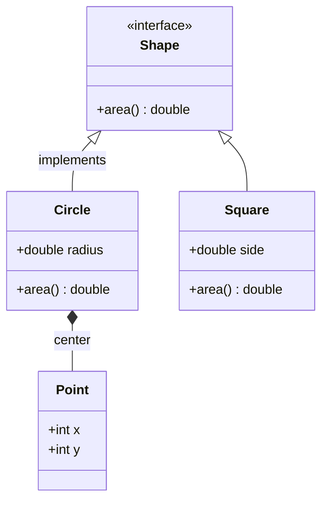

## Frames

The ascent profile, opaque:

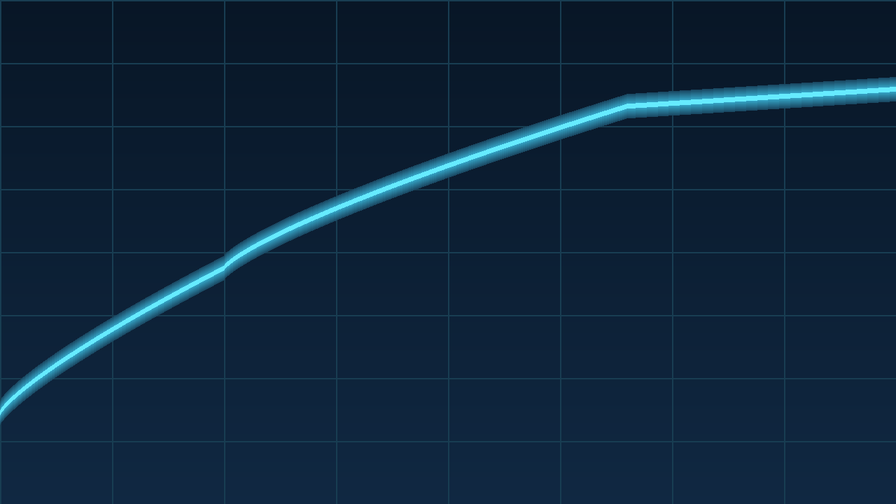

Two sensor footprints with partial coverage:

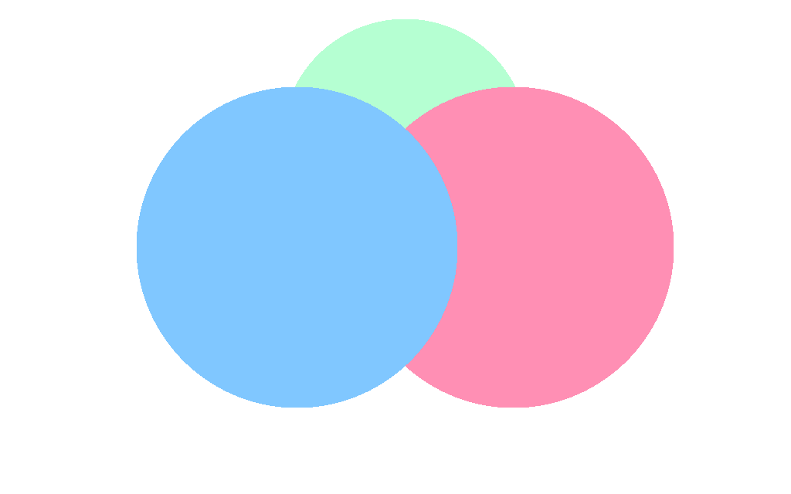

An animated countdown loop:


Frames that must not load, because they point at a remote URL, escape the log
directory, or are simply not there:


