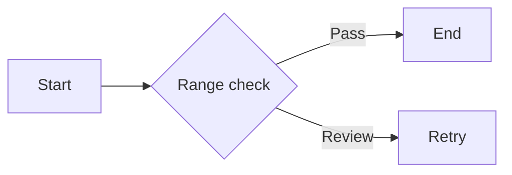
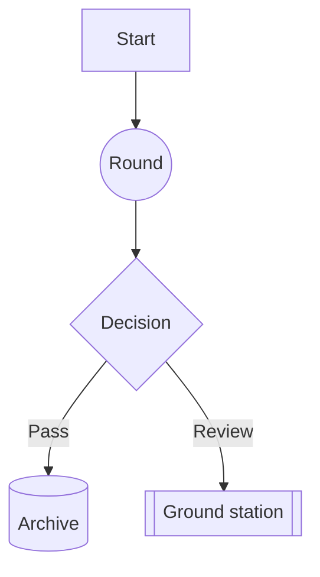
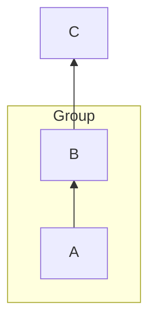
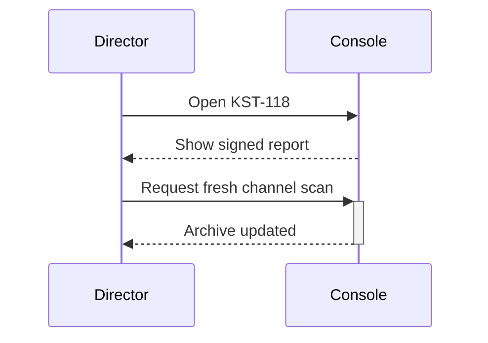
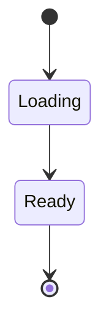
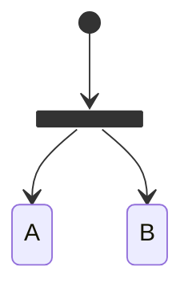
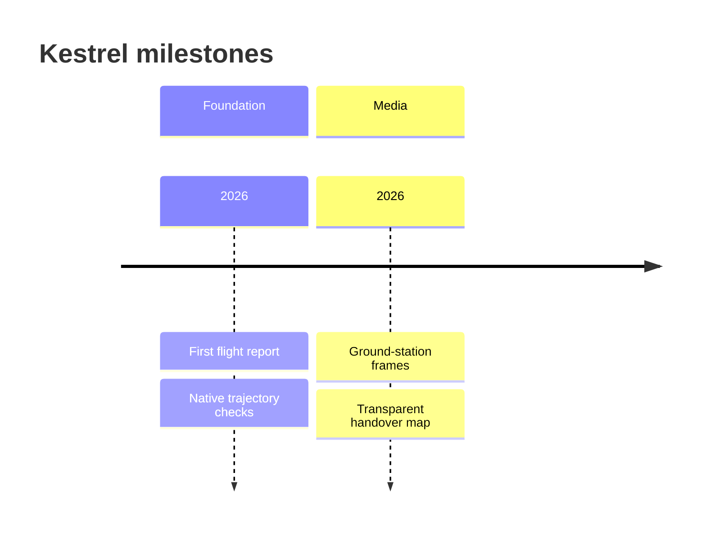
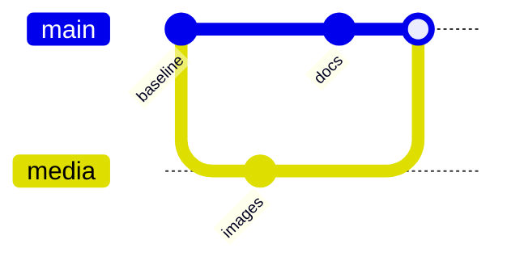
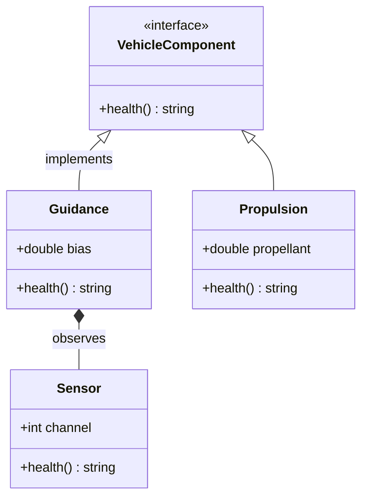

# Kestrel mission dossier

The complete KST-118 review in one page: a shift handover, a few working notes,
the calculations behind the insertion estimate, and the diagrams and frames
that make the evidence easier to audit.

## The watch console

Kestrel turns a raw flight log into a readable terminal report without hiding
the raw material. The night shift can move from a sentence to a code sample, a
table, a formula, or a sensor frame without leaving the terminal.

### A note from the flight director

Reports mix *observations*, **decisions** and `channel names`; a cross-reference
such as [the OpenTUI project](https://github.com/anomalyco/opentui) keeps its label.
The source remains readable when a terminal cannot display a formula, diagram, or image.

### The review order

> Every figure in a report has to survive being read over SSH, on a terminal
> that cannot draw a single pixel. When a frame or a formula cannot be
> rendered, the source is printed instead of a broken image.

The review proceeds in the same order as the operation:

- Flight data
  - altitude and velocity
  - propellant mass and mode changes
- Analysis
  - equations and tolerances
  - diagrams and image evidence
1. Confirm the recorder and time base.
2. Decode the state transitions.
3. Sign the report only after the evidence agrees.

---

## A small archive check

```js
// Application-specific loader used by the fictional host:
const report = await openFlightReport("KST-118")

function lastBeacon(report) {
  return report.flight.samples
    .filter((sample) => sample.channel === "beacon")
    .at(-1)
}
console.log(lastBeacon(report))
```

## Quick-look table

| Event | Time | Status |
|------|:------:|------:|
| MECO | T+63 s | nominal |
| Insertion | T+512 s | signed |

## Math

Inline: $E = mc^2$, $x^2 + y^2 = r^2$, $\sqrt{x+1}$

Display:
$$
\int_0^\infty e^{-x}\,dx = 1
$$

Display style moves the limits of a large operator above and below it, and the
scope handles the commands Typst has no direct equivalent for:
$$
\sum_{k=0}^{n} \frac{1}{2^k} = 2 - \frac{1}{2^n}, \qquad \sqrt[3]{\frac{a}{b}}
$$

Truncated, and therefore left as source: $$\frac{1}{ $$

## Mission diagrams

### From recorder to signed report







### Ground-station handoff



### Vehicle states





### The processing window

```mermaid
gantt
  dateFormat s
  section Mission review
  Decode recorder :0, 2
  Check trajectory :active, 2, 5
  Sign report :3, 7
```



### Milestones



### Release history



### The vehicle model



## Telemetry frames

The opaque ascent profile stays readable against the dark console:


The transparent overlap marks the ground-station handover:


The countdown loop is retained as a timed asset:


These sources must not load: they point to the network, escape the archive, or
refer to an asset that was never recorded:


