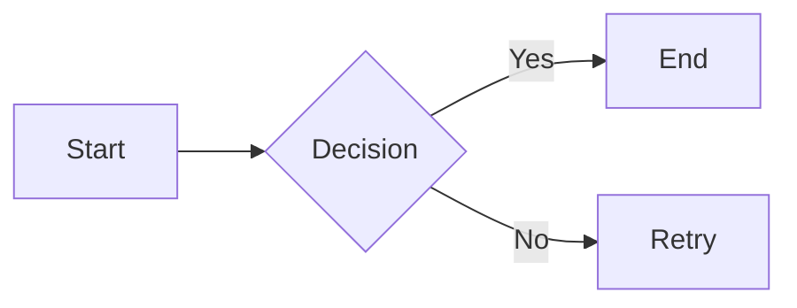
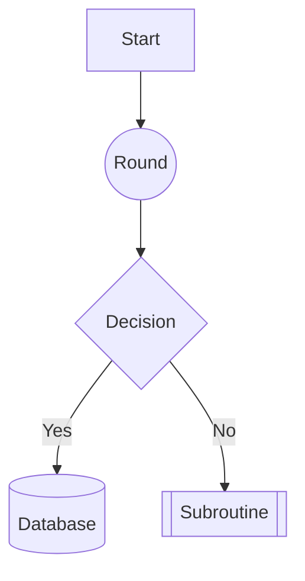
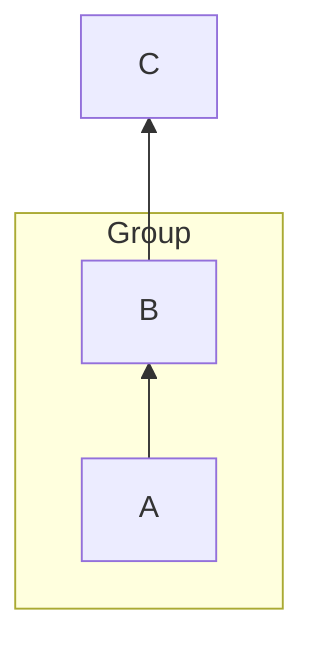
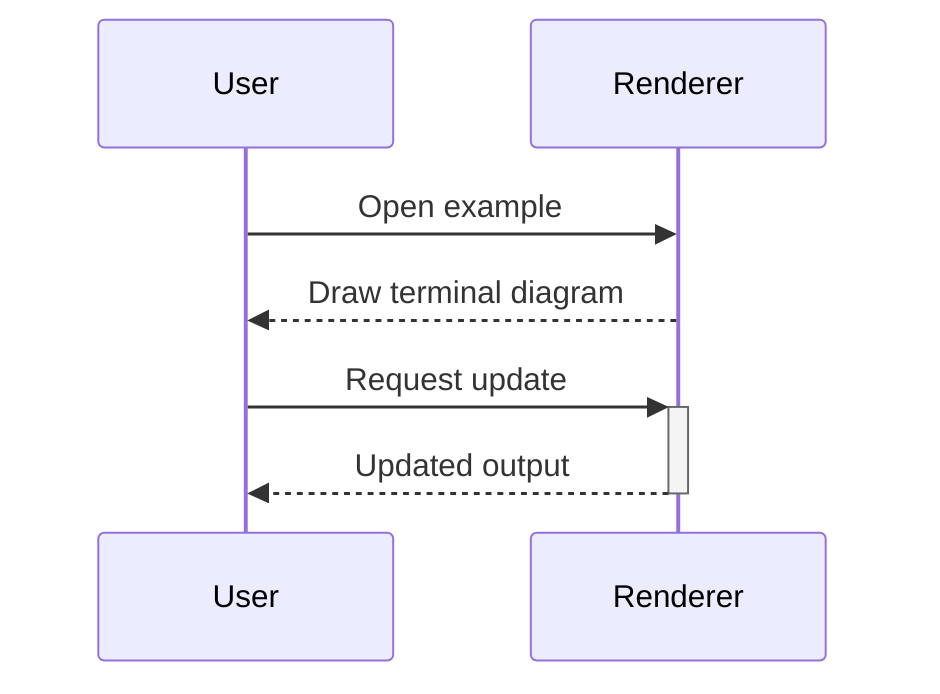
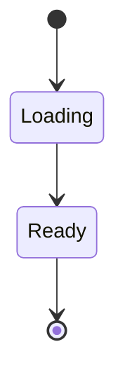
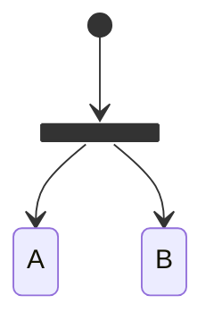
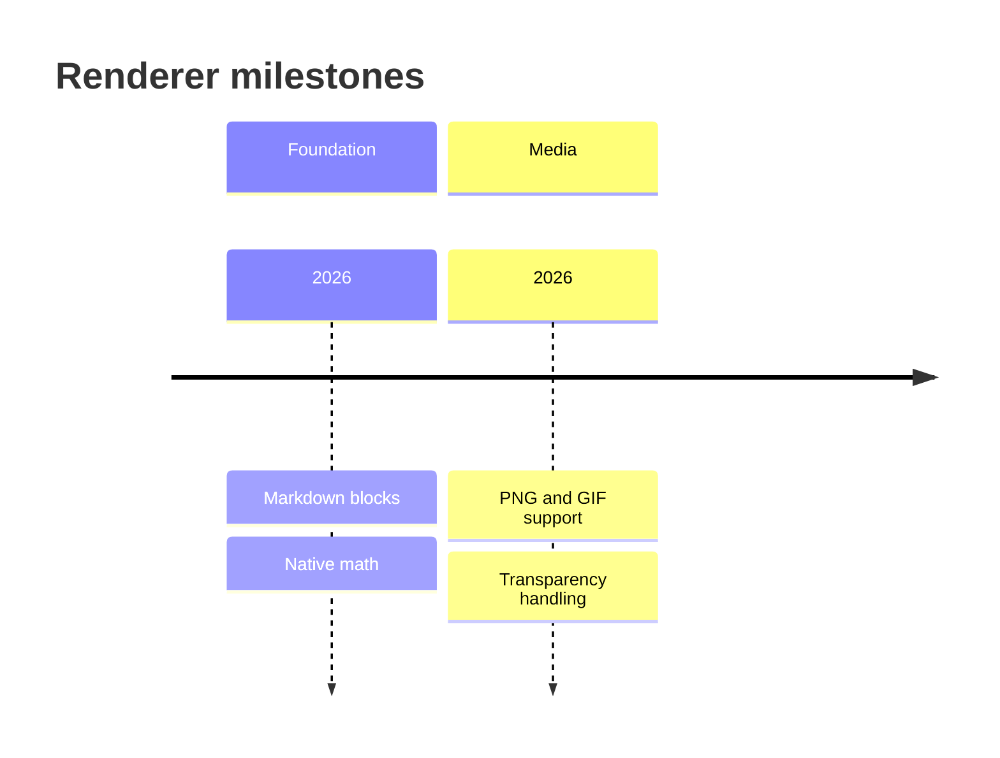
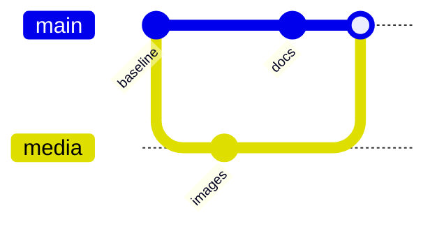
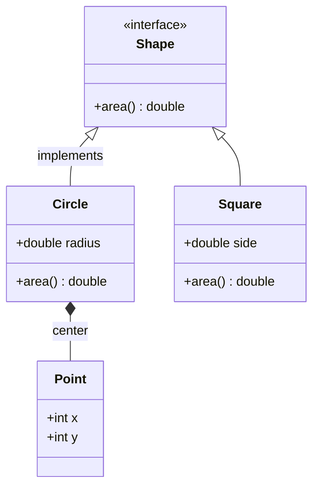

# All-in-One Demo

## Headings, Text & Links

### Formatting
This is *italic*, **bold**, and `inline code`.

[OpenTUI](https://github.com/sst/opentui)

### Blockquote
> A blockquote for emphasis.

### Lists
- Unordered item 1
- Unordered item 2
  - Nested item
1. Ordered one
2. Ordered two

### Thematic Break
---

## Code Block

```js
function greet(name) {
  return `Hello, ${name}!`
}
console.log(greet("world"))
```

## Tables

| Left | Center | Right |
|------|:------:|------:|
| A    | B      | C     |
| 1    | 2      | 3     |

## Math

Inline: $E = mc^2$, $x^2 + y^2 = r^2$, $\sqrt{x+1}$

Display:
$$
\int_0^\infty e^{-x}\,dx = 1
$$

Truncated (should show source): $$\frac{1}{ $$

## Mermaid

### Flowchart (multiple directions and node shapes)






### Sequence Diagram


### State Diagram (v2)




### Gantt Chart

```mermaid
gantt
  dateFormat s
  section Render
  Parse Markdown :0, 2
  Typeset math :active, 2, 5
  Draw media :3, 7
```


### Timeline


### Git Graph


### Class Diagram


## Images

Opaque PNG:


Transparent PNG:


Animated GIF:


Failure cases (must not load network assets or escape the example root):


