# Class Diagram Edge Cases

Thirty large `classDiagram` fixtures that stress the vendored renderer across
layout, routing, and vocabulary edge cases. Scroll to compare; `t` cycles the
theme and `q` quits.

## 1. Deep single-inheritance chain

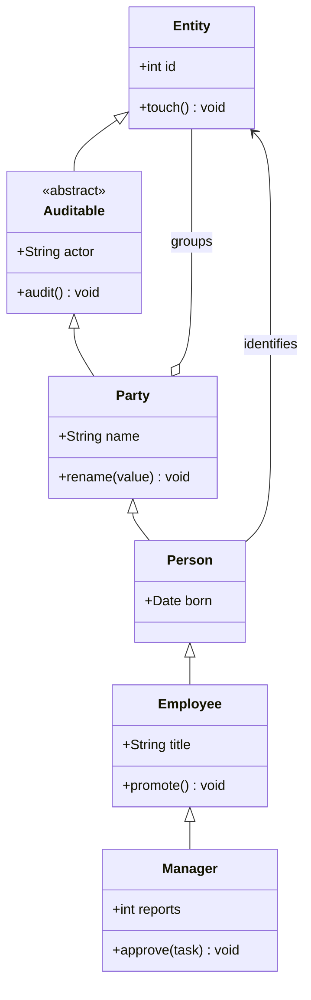

## 2. Wide fan-out

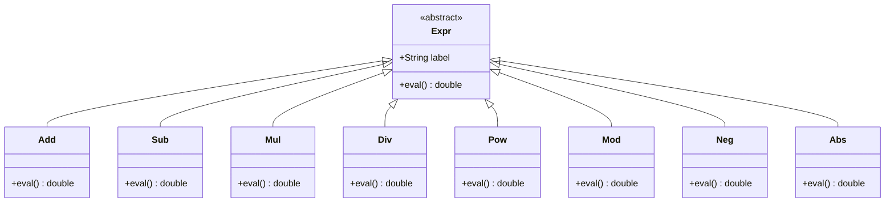

## 3. Every relationship kind

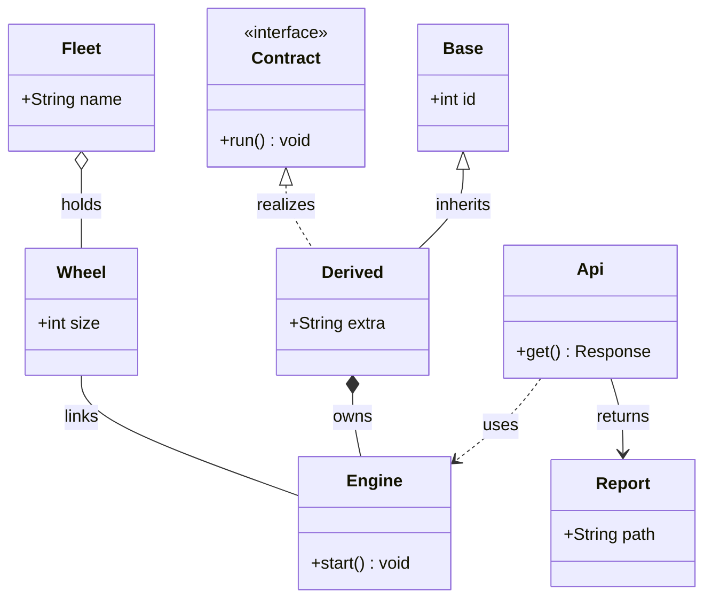

## 4. Diamond inheritance

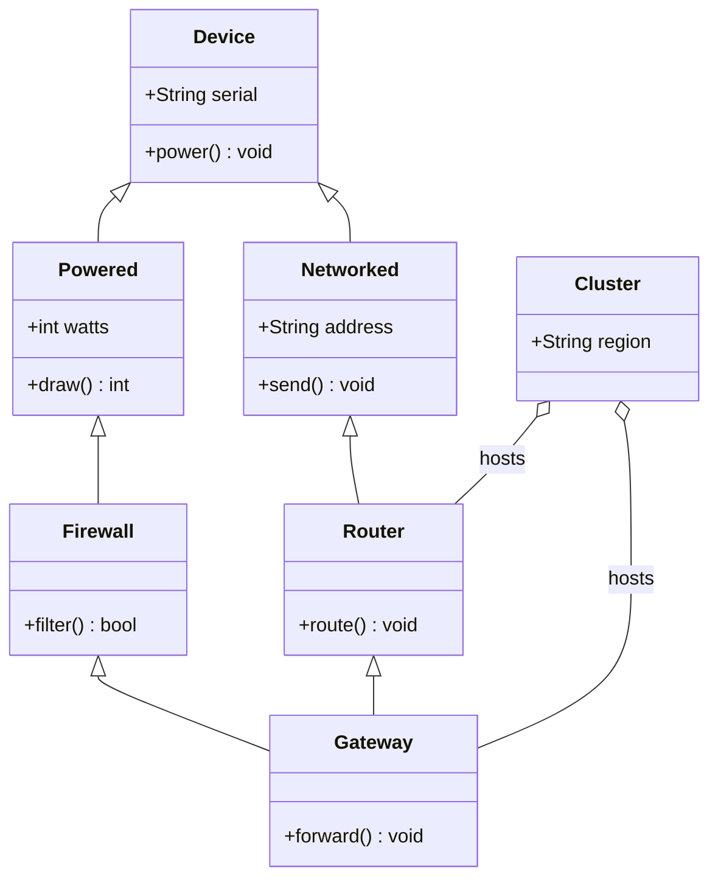

## 5. Composition tree

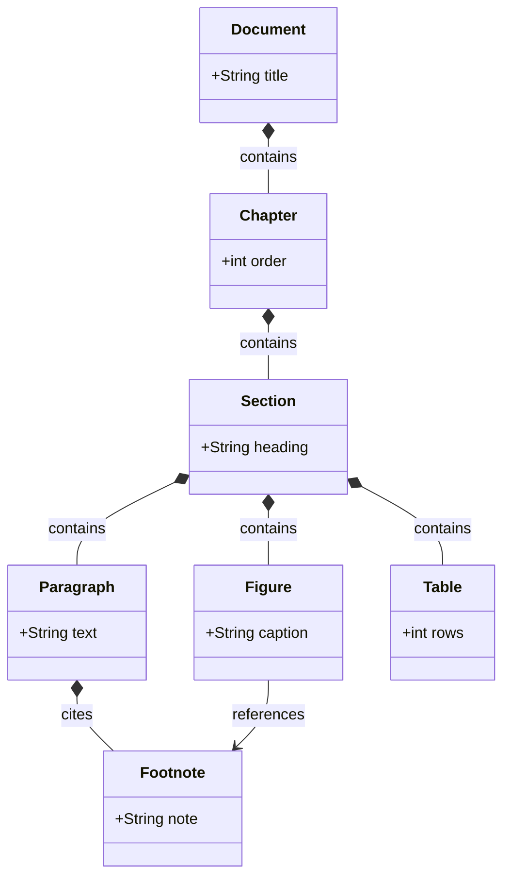

## 6. Aggregation network

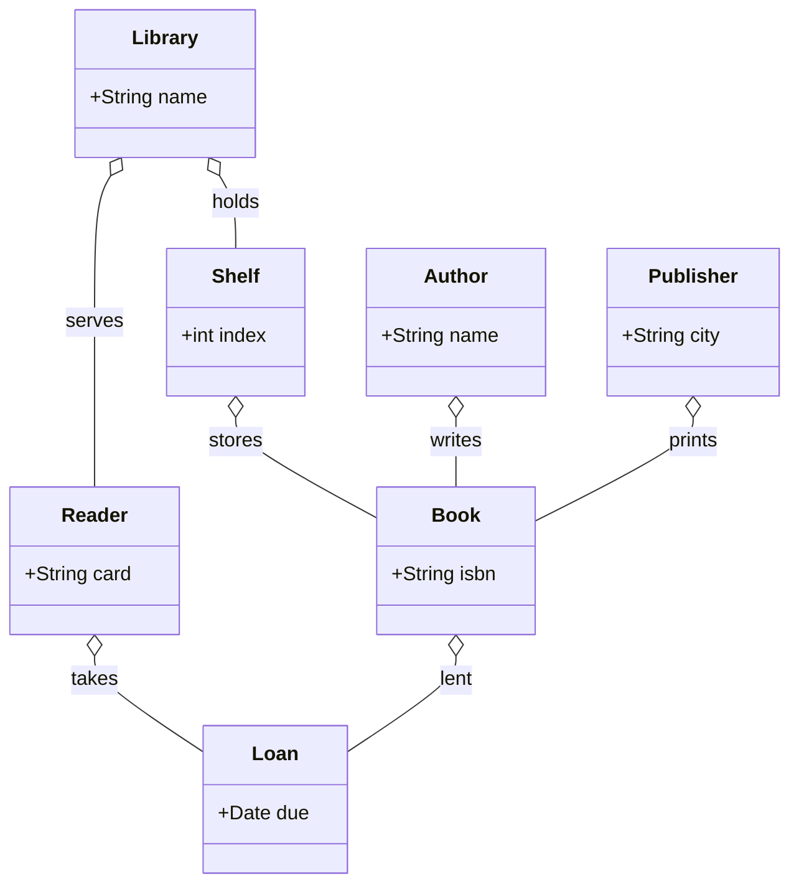

## 7. Layered architecture with long edges

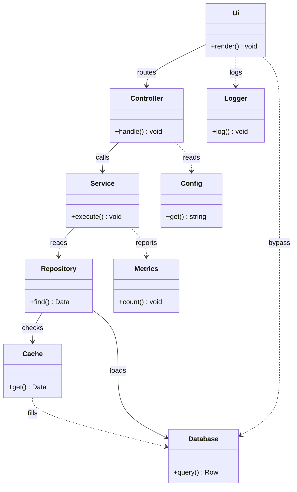

## 8. Dense mesh

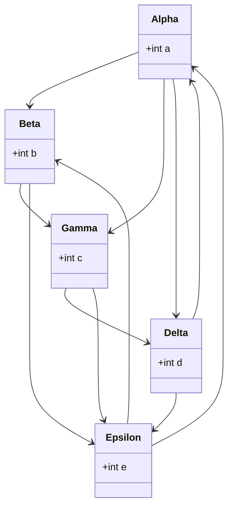

## 9. Direction LR

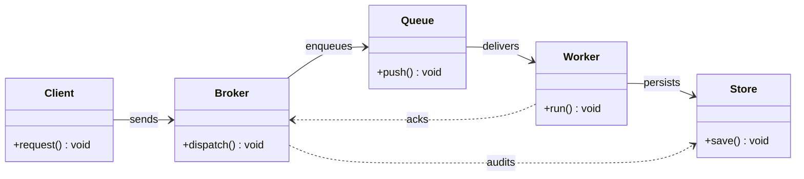

## 10. Direction RL

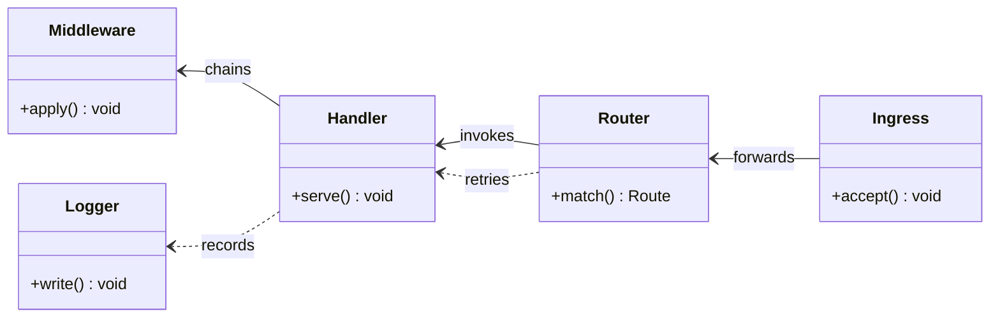

## 11. Direction BT

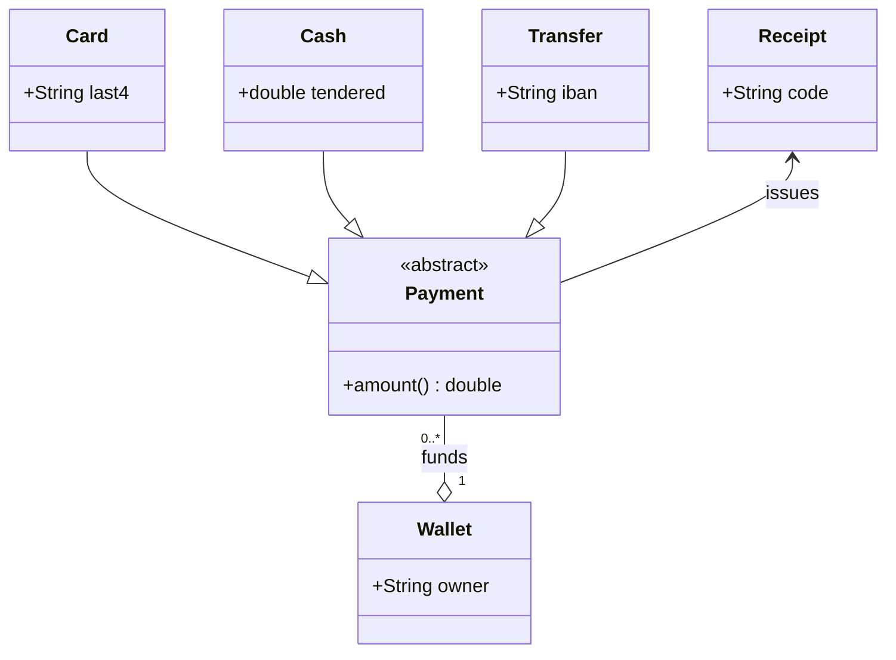

## 12. Bidirectional associations

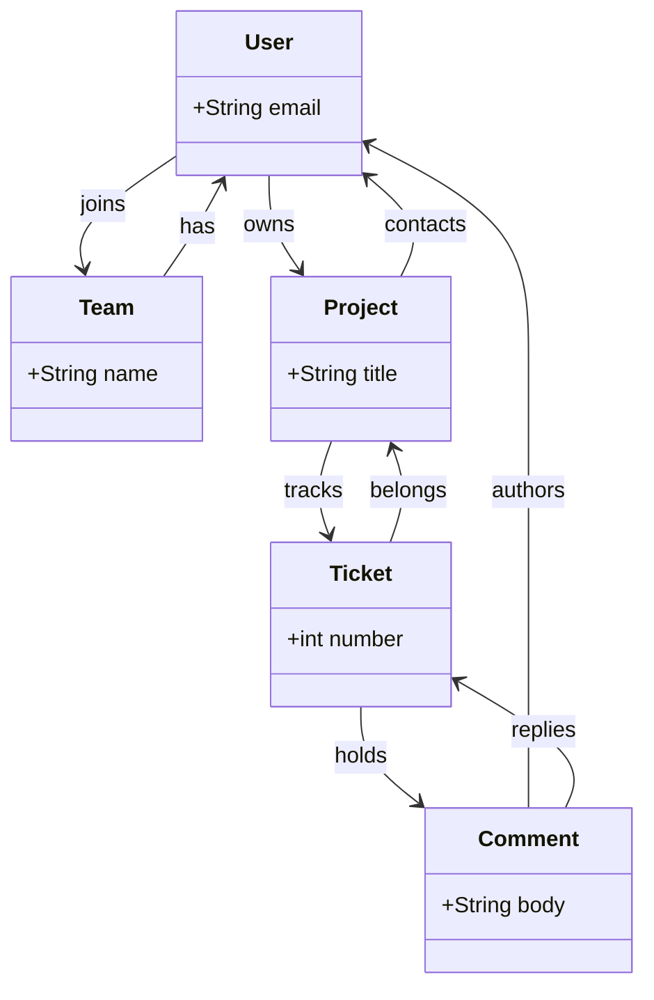

## 13. Self loops and cycles

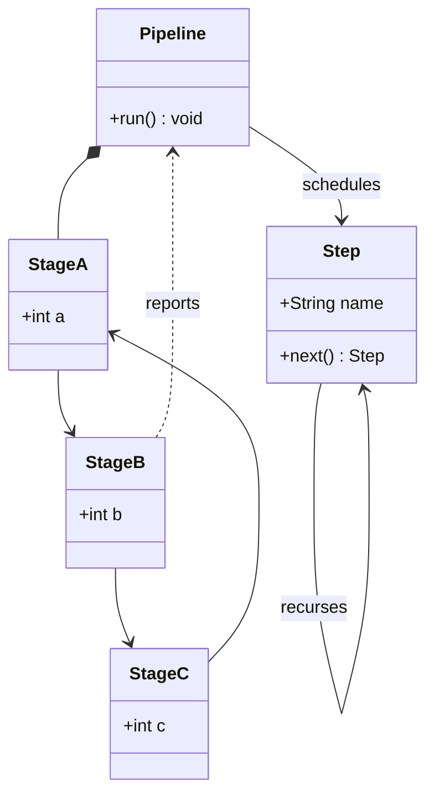

## 14. Disconnected clusters

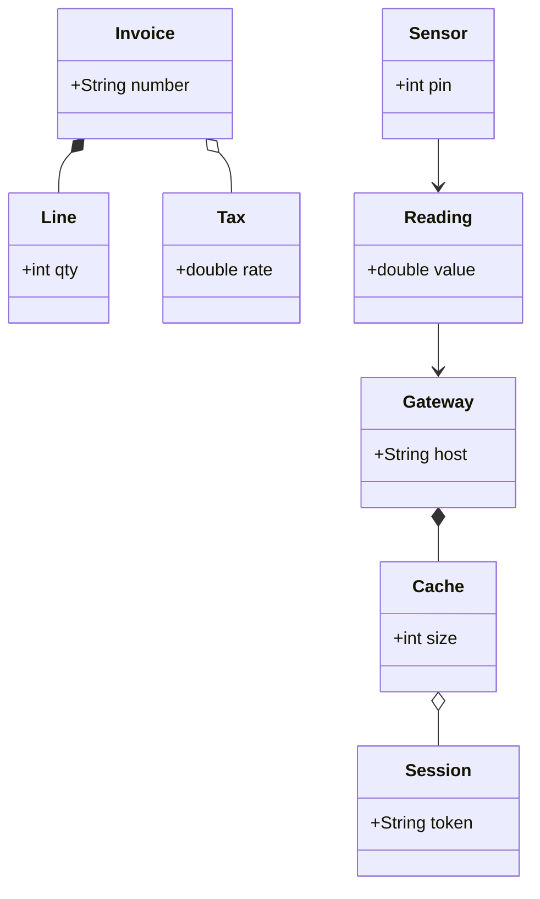

## 15. Corridor routing stress

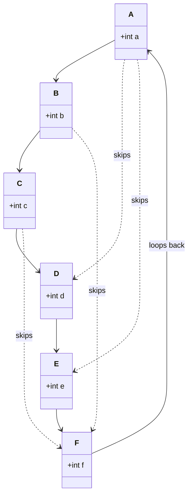

## 16. Heavy labels and multiplicities

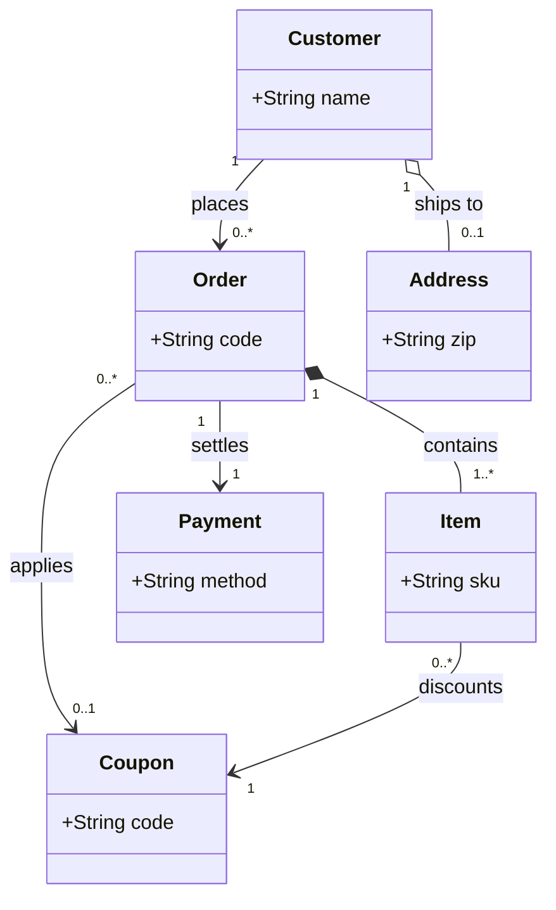

## 17. Stereotype variety

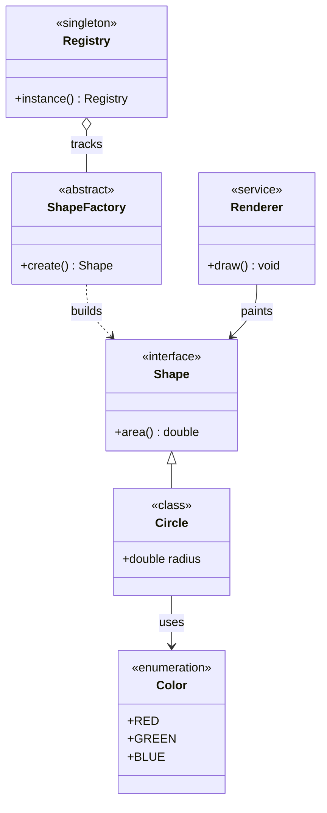

## 18. Generic and collection members

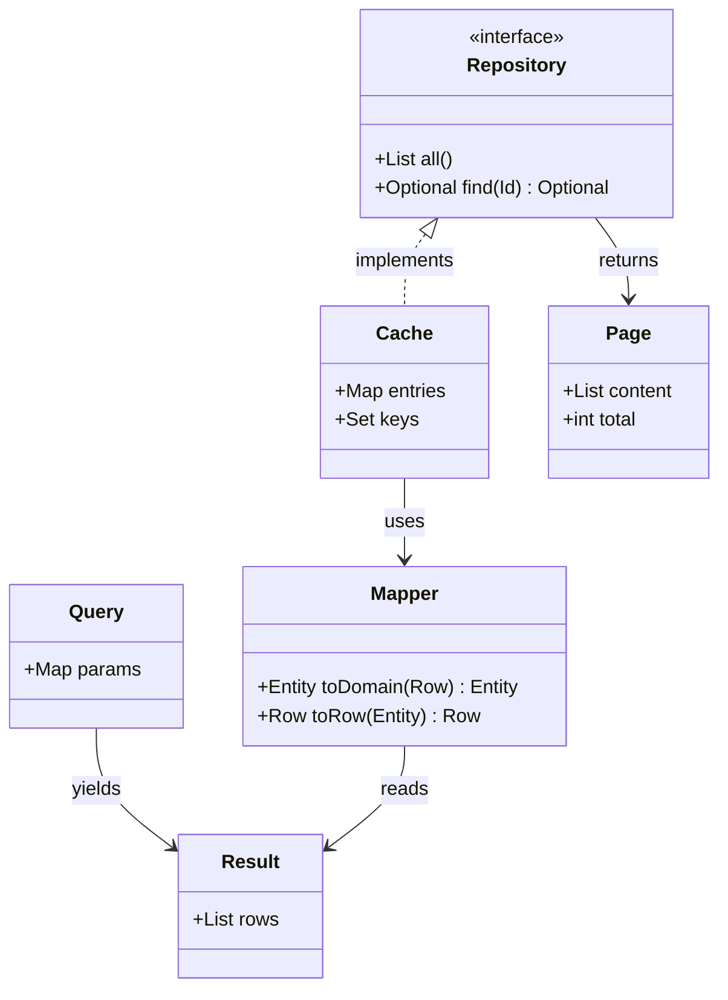

## 19. Quoted and special class names

```mermaid
classDiagram
  class "Order Service" {
    +place() void
  }
  class "Order Repository" {
    +save() void
  }
  class order_events {
    +String kind
  }
  class "order.line" {
    +int qty
  }
  class audit~v2 {
    +String actor
  }
  "Order Service" --> "Order Repository" : writes
  "Order Repository" --> order_events : emits
  order_events --> "order.line" : expands
  "order.line" --> audit~v2 : records
  audit~v2 --> "Order Service" : notifies
```

## 20. Cyclic dependencies

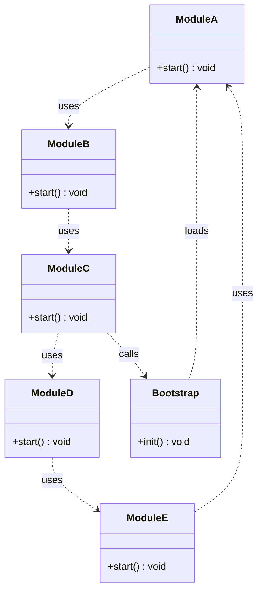

## 21. Layered with cross links

```mermaid
classDiagram
  direction TB
  class View {
    +paint() void
  }
  class ViewModel {
    +bind() void
  }
  class Model {
    +load() void
  }
  class Store {
    +get() Data
  }
  class Network {
    +fetch() Data
  }
  class Disk {
    +read() Data
  }
  class Telemetry {
    +emit() void
  }
  View --> ViewModel : observes
  ViewModel --> Model : reads
  Model --> Store : queries
  Store --> Network : refreshes
  Store --> Disk : caches
  View ..> Telemetry : tracks
  Network ..> Telemetry : tracks
  Disk ..> Telemetry : tracks
  ViewModel ..> Disk : warms
```

## 22. Branching tree

```mermaid
classDiagram
  class Root {
    +String id
  }
  class Left {
    +int l
  }
  class Middle {
    +int m
  }
  class Right {
    +int r
  }
  class LeftA {
    +int la
  }
  class LeftB {
    +int lb
  }
  class RightA {
    +int ra
  }
  class RightB {
    +int rb
  }
  class Leaf {
    +int v
  }
  Root *-- Left
  Root *-- Middle
  Root *-- Right
  Left *-- LeftA
  Left *-- LeftB
  Right *-- RightA
  Right *-- RightB
  LeftB --> Leaf : carries
  RightB --> Leaf : carries
  Middle --> Leaf : carries
```

## 23. Bipartite publishers and subscribers

```mermaid
classDiagram
  class PublisherA {
    +publish() void
  }
  class PublisherB {
    +publish() void
  }
  class PublisherC {
    +publish() void
  }
  class SubscriberX {
    +onEvent() void
  }
  class SubscriberY {
    +onEvent() void
  }
  class SubscriberZ {
    +onEvent() void
  }
  class Bus {
    +route() void
  }
  PublisherA --> Bus
  PublisherB --> Bus
  PublisherC --> Bus
  Bus --> SubscriberX
  Bus --> SubscriberY
  Bus --> SubscriberZ
  PublisherA ..> SubscriberZ : direct
  PublisherC ..> SubscriberX : direct
```

## 24. Chain with cross edges

```mermaid
classDiagram
  class L1 {
    +int v
  }
  class L2 {
    +int v
  }
  class L3 {
    +int v
  }
  class L4 {
    +int v
  }
  class L5 {
    +int v
  }
  class L6 {
    +int v
  }
  L1 --> L2
  L2 --> L3
  L3 --> L4
  L4 --> L5
  L5 --> L6
  L1 ..> L3 : skip
  L2 ..> L5 : skip
  L3 ..> L6 : skip
  L6 --> L1 : back
  L4 --> L2 : cross
```

## 25. Realization heavy

```mermaid
classDiagram
  class Serializable {
    <<interface>>
    +serialize() string
  }
  class Comparable {
    <<interface>>
    +compare(other) int
  }
  class Cloneable {
    <<interface>>
    +clone() Object
  }
  class Entity {
    +int id
  }
  class User {
    +String name
  }
  class Account {
    +double balance
  }
  Serializable <|.. Entity : implements
  Comparable <|.. User : implements
  Cloneable <|.. User : implements
  Serializable <|.. Account : implements
  Cloneable <|.. Account : implements
  Entity <|-- User
  Entity <|-- Account
```

## 26. Composition heavy

```mermaid
classDiagram
  class App {
    +run() void
  }
  class Window {
    +show() void
  }
  class Toolbar {
    +draw() void
  }
  class Canvas {
    +clear() void
  }
  class StatusBar {
    +set() void
  }
  class Button {
    +click() void
  }
  class Icon {
    +String path
  }
  App *-- Window
  Window *-- Toolbar
  Window *-- Canvas
  Window *-- StatusBar
  Toolbar *-- Button
  Button *-- Icon
  Canvas *-- Grid : draws
  Grid *-- Cell : holds
  class Grid {
    +int cols
  }
  class Cell {
    +String glyph
  }
```

## 27. Association heavy with multiplicities

```mermaid
classDiagram
  class Course {
    +String code
  }
  class Student {
    +String id
  }
  class Teacher {
    +String name
  }
  class Room {
    +String label
  }
  class Exam {
    +Date date
  }
  class Grade {
    +double value
  }
  Course "1" --> "0..*" Student : enrolls
  Teacher "1" --> "1..*" Course : teaches
  Course "1" --> "0..1" Room : uses
  Course "1" --> "1..*" Exam : schedules
  Student "1" --> "0..*" Exam : takes
  Exam "1" --> "0..*" Grade : yields
  Grade "0..*" --> "1" Student : belongs
```

## 28. Accessibility and comments

```mermaid
classDiagram
  accTitle: Commerce model
  accDescr: Orders, items and payments
  %% domain core
  class Order {
    +String code
    +total() double
  }
  class Item {
    +String sku
    +int qty
  }
  class Payment {
    +double value
    +capture() void
  }
  class Customer {
    +String name
  }
  class Address {
    +String zip
  }
  class Shipment {
    +String tracking
  }
  %% relationships
  Customer "1" --> "0..*" Order : places
  Order "1" *-- "1..*" Item : contains
  Order "1" --> "1" Payment : settles
  Order "1" --> "0..1" Shipment : ships
  Customer "1" o-- "0..1" Address : bills
  Item "0..*" --> "1" Payment : billed
```

## 29. Very wide sibling rank

```mermaid
classDiagram
  class Hub {
    +route() void
  }
  class N1 {
    +int v
  }
  class N2 {
    +int v
  }
  class N3 {
    +int v
  }
  class N4 {
    +int v
  }
  class N5 {
    +int v
  }
  class N6 {
    +int v
  }
  class N7 {
    +int v
  }
  class N8 {
    +int v
  }
  class N9 {
    +int v
  }
  class N10 {
    +int v
  }
  Hub --> N1
  Hub --> N2
  Hub --> N3
  Hub --> N4
  Hub --> N5
  Hub --> N6
  Hub --> N7
  Hub --> N8
  Hub --> N9
  Hub --> N10
```

## 30. Very tall rank chain

```mermaid
classDiagram
  direction TB
  class R1 {
    +int v
  }
  class R2 {
    +int v
  }
  class R3 {
    +int v
  }
  class R4 {
    +int v
  }
  class R5 {
    +int v
  }
  class R6 {
    +int v
  }
  class R7 {
    +int v
  }
  class R8 {
    +int v
  }
  class Side1 {
    +int s
  }
  class Side2 {
    +int s
  }
  R1 --> R2
  R2 --> R3
  R3 --> R4
  R4 --> R5
  R5 --> R6
  R6 --> R7
  R7 --> R8
  Side1 --> R4
  Side2 --> R6
  R8 ..> Side1 : returns
```
