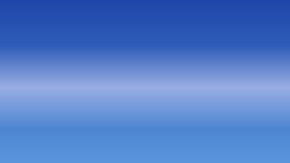
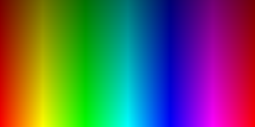

# Local Images

Opaque PNG:

Transparent PNG composited against the theme background:

Color spectrum:

Checker pattern:

Animated GIF:

These failure cases must not load network assets or escape the example root:

