# Mermaid

## Flowchart

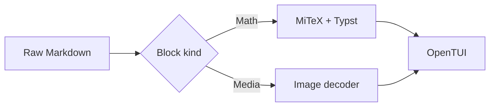

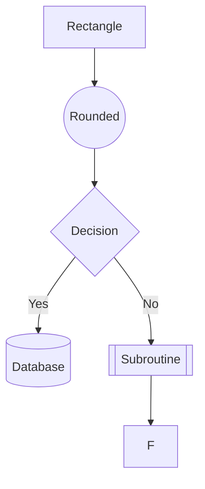

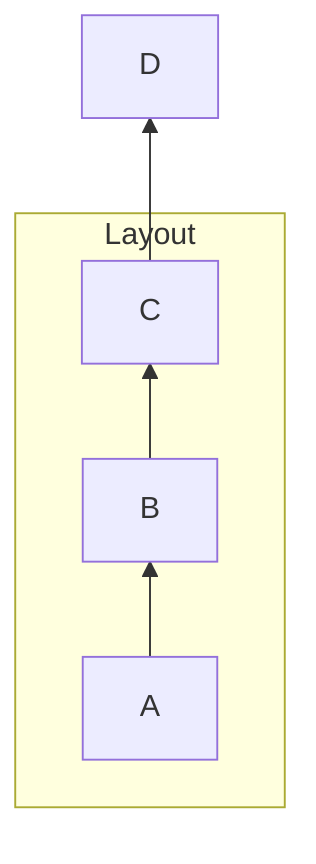

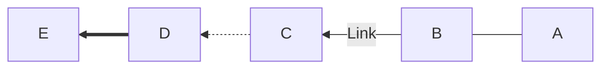

## Sequence Diagram

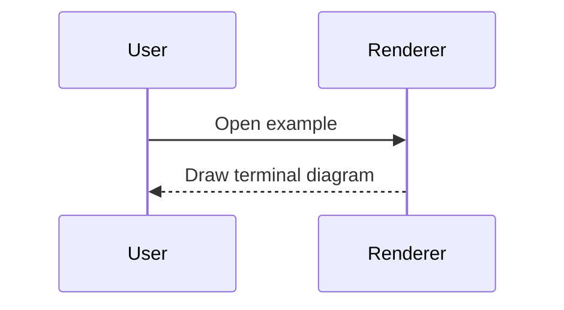

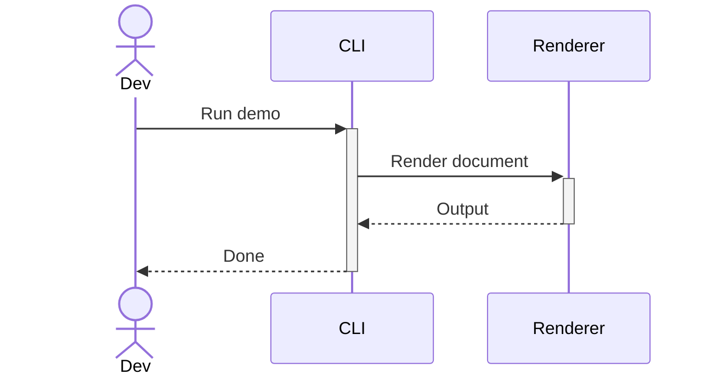

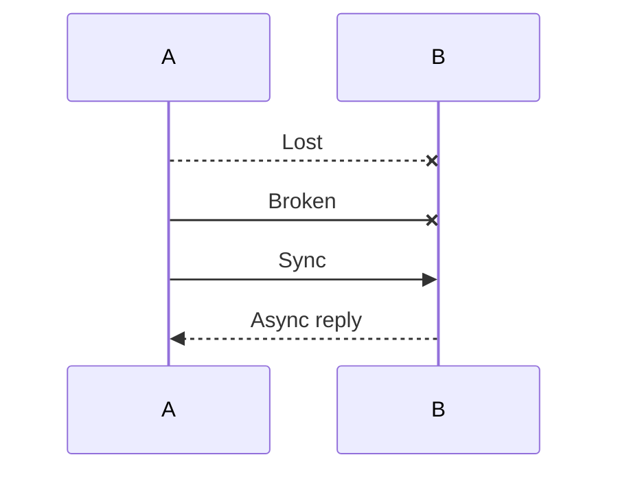

## State Diagram (v2)

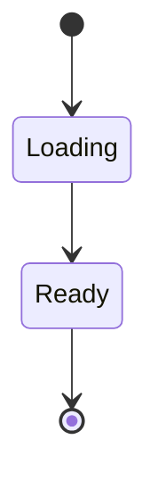

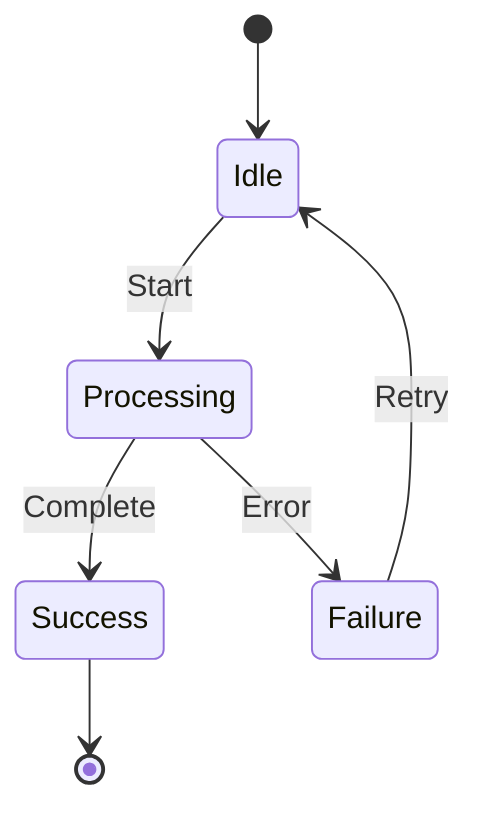

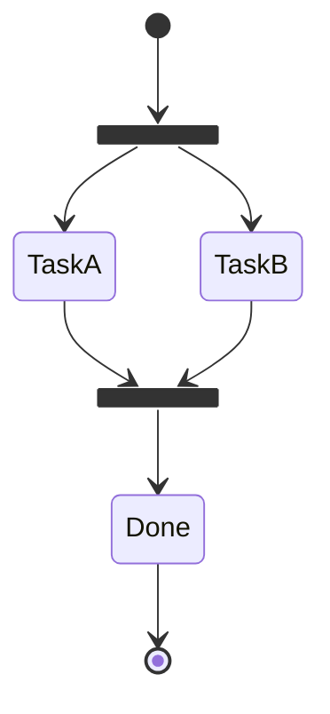

## Gantt Chart

```mermaid
gantt
  dateFormat s
  section Render
  Parse Markdown :0, 2
  Typeset math :active, 2, 5
  Draw media :3, 7
```

```mermaid
gantt
  title Build Pipeline
  dateFormat HH:mm
  section Core
  Scan :a1, 00:00, 2h
  Inline :after a1, 3h
  section Extensions
  Mermaid :00:30, 2h
  Math :1h, 2h
```

## Timeline

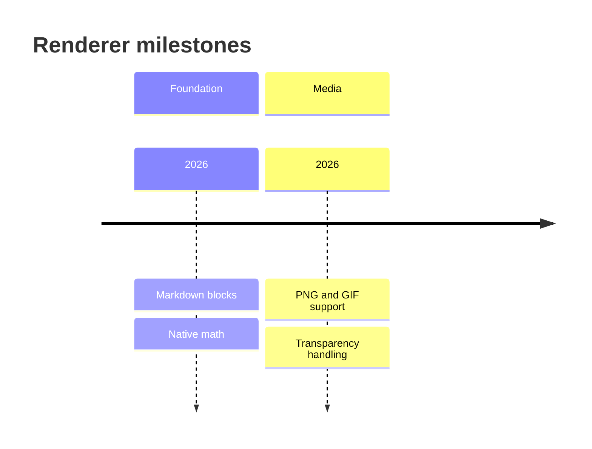

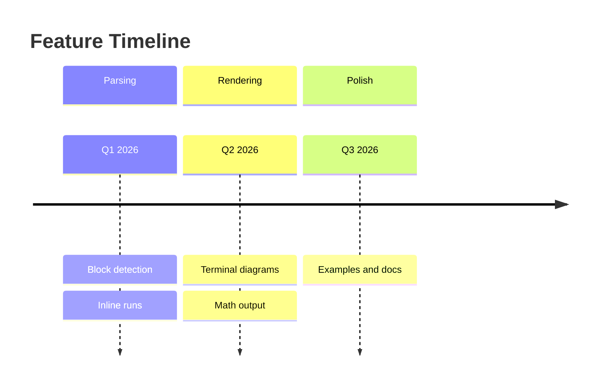

## Git Graph

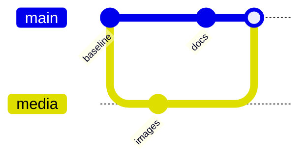

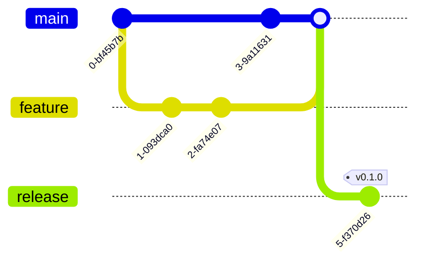

## Class Diagram

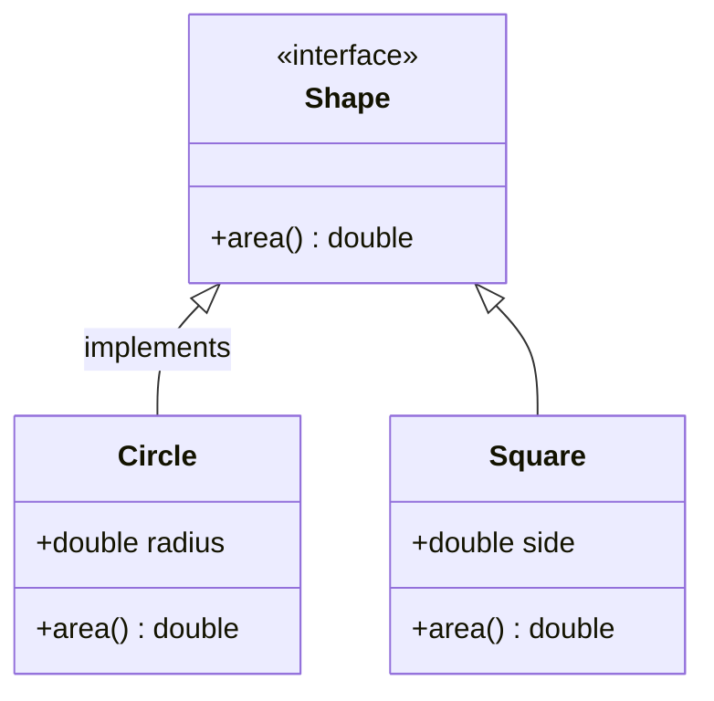

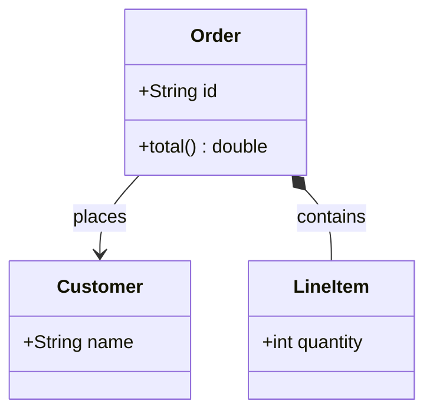

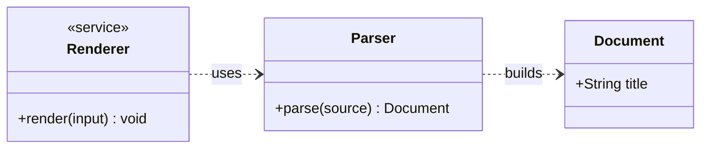

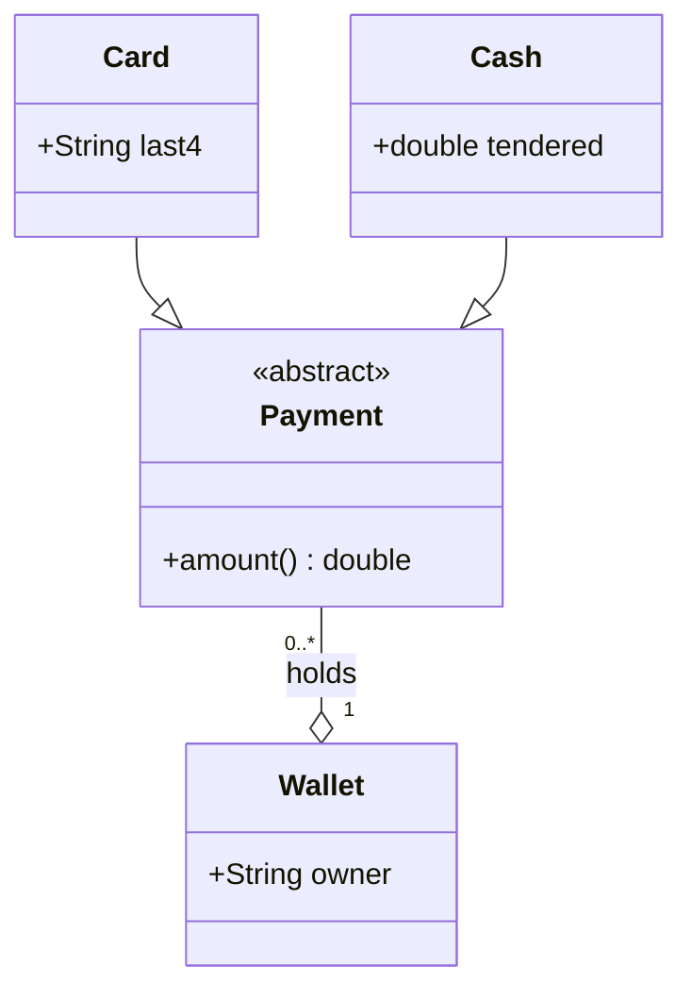

```mermaid
classDiagram
  class Notifier {
    <<interface>>
    +send(message) void
  }
  class Store {
    +save(key, value) void
  }
  class Logger {
    +log(line) void
  }
  Notifier <|.. Store : implements
  Store -- Logger : uses
```

Invalid class syntax falls back to the source fence:

```mermaid
classDiagram
  class Animal {
    +String name
  }
  note for Animal "Not supported"
```
