# Mission architecture and syntax reference

Every diagram family Kestrel can draw, presented through the KST-118 scenario.
The operational examples are mixed with a few deliberately generic syntax
fixtures, because this page is also a renderer reference. Scroll to compare;
`c` opens the configuration panel to switch themes and `q` asks to quit.

## The evidence pipeline

How a raw log becomes a report that can be signed:

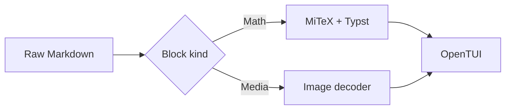

### Node shapes in the console

The same handoff drawn with every shape the console knows:

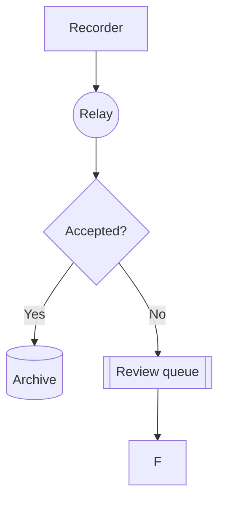

### Layout direction

`BT` lays a group out from the bottom, matching the vehicle's stacked stages:

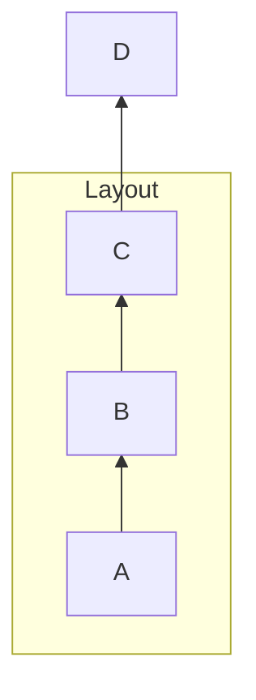

### Link kinds on the downlink

Solid, arrowed, dotted and thick links exercise different Mermaid link styles.
They do not imply confidence levels unless the host application assigns that
meaning:

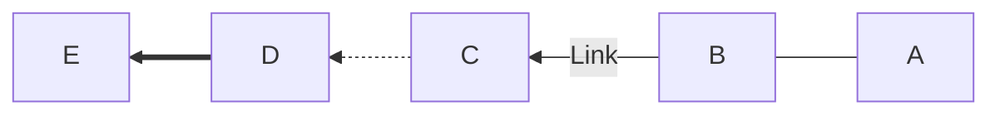

### More flowchart syntax

Multiple statements per line, a parallelogram and a hexagon:

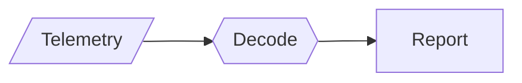

## The launch handoff

What happens between the recorder and the ground console:

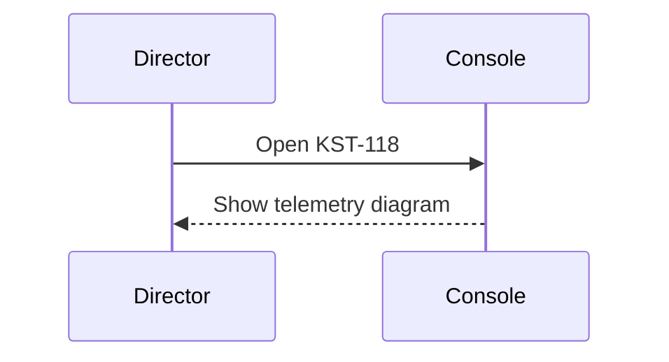

### A full shift handoff

From the command line through the decoder and back to the operator:

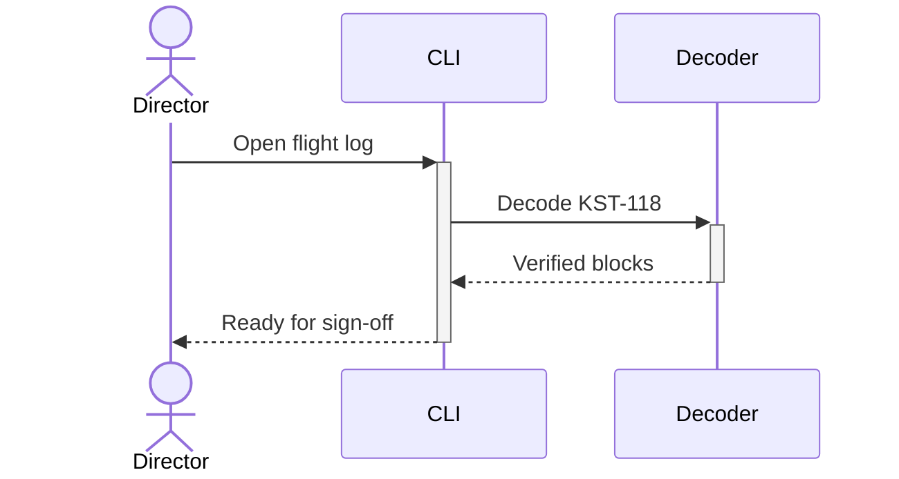

### Message kinds during recovery

Lost, broken, synchronous and asynchronous messages model a noisy radio pass:

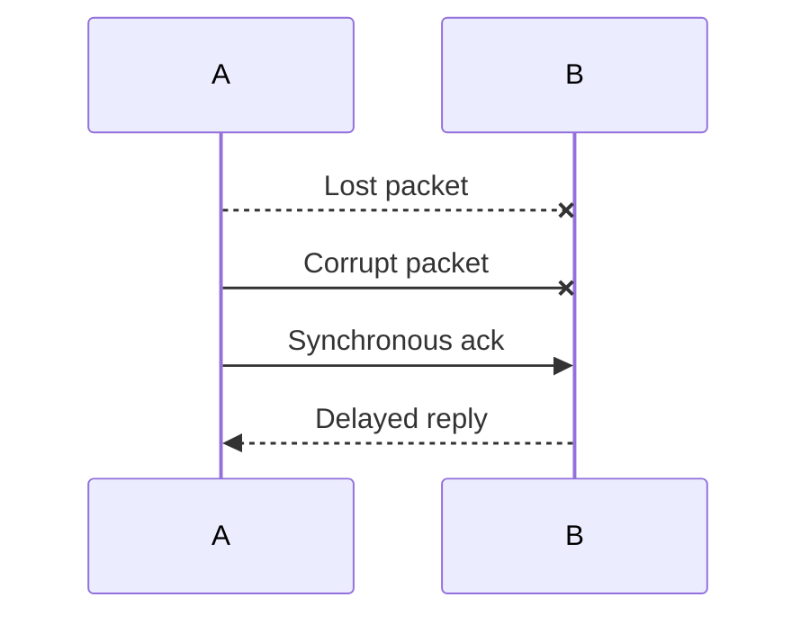

### Parallel and optional messages

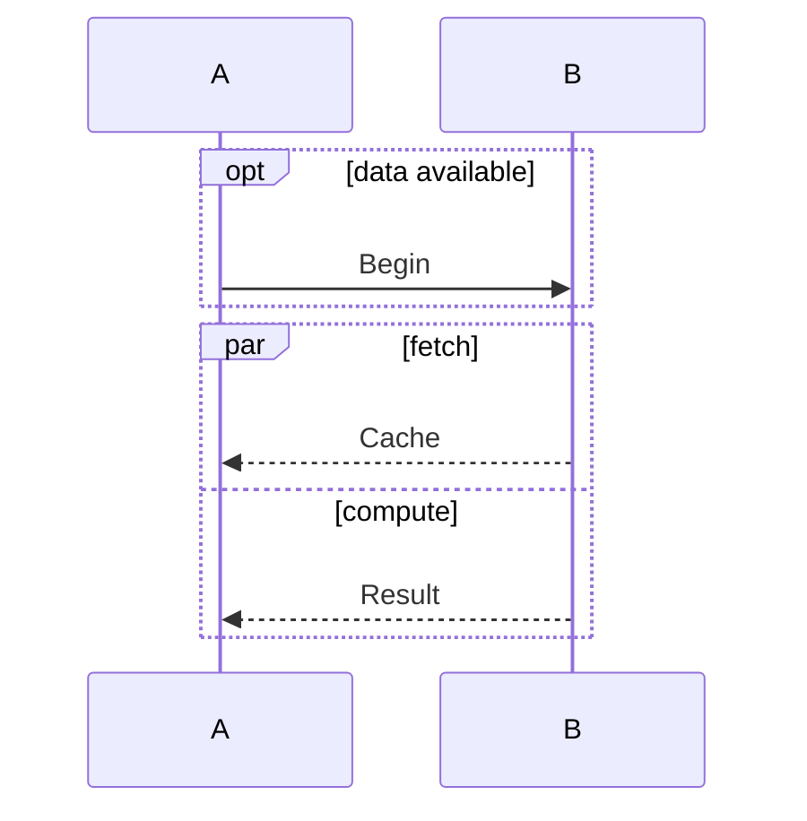

## Vehicle states

The states a vehicle passes through from pad release to archive:

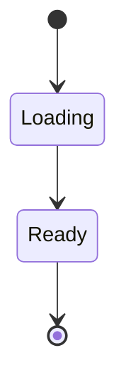

### A flight with a recovery path

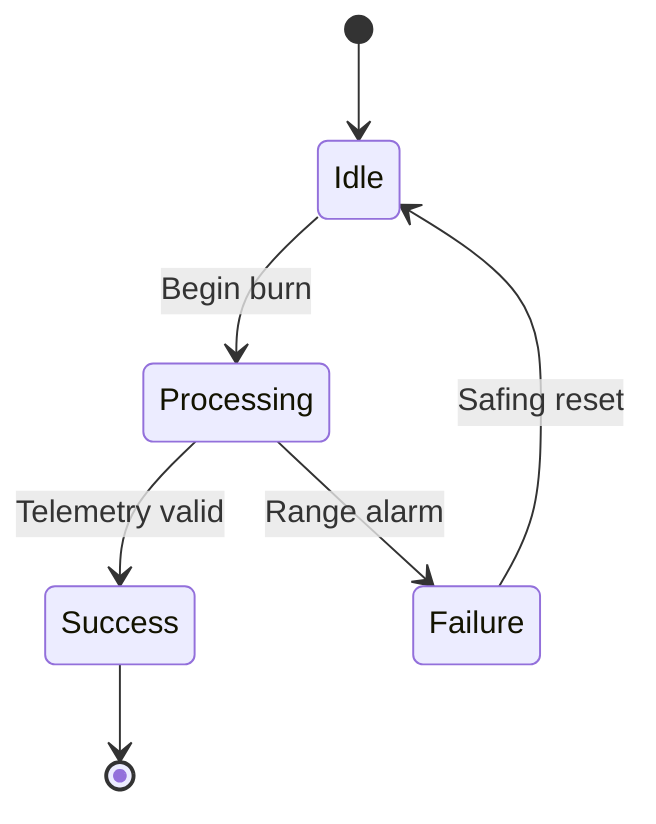

### Parallel ground checks

Parallel checks that have to meet before sign-off:

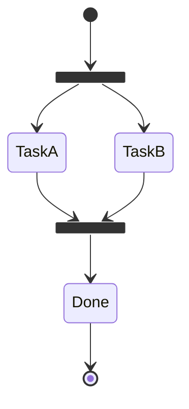

## Countdown

The short schedule for assembling a launch-window report:

```mermaid
gantt
  dateFormat s
  section Mission review
  Decode recorder :0, 2
  Check trajectory :active, 2, 5
  Attach frames :3, 7
```

### A ground-station pipeline

Two tracks that overlap while the vehicle is in view:

```mermaid
gantt
  title Ground station handoff
  dateFormat HH:mm
  tickInterval 1h
  section Coastal station
  Acquire :a1, 00:00, 2h
  Calibrate :after a1, 3h
  section Inland relay
  Decode :00:30, 2h
  Archive :1h, 2h
```

## Milestones

When each capability landed:

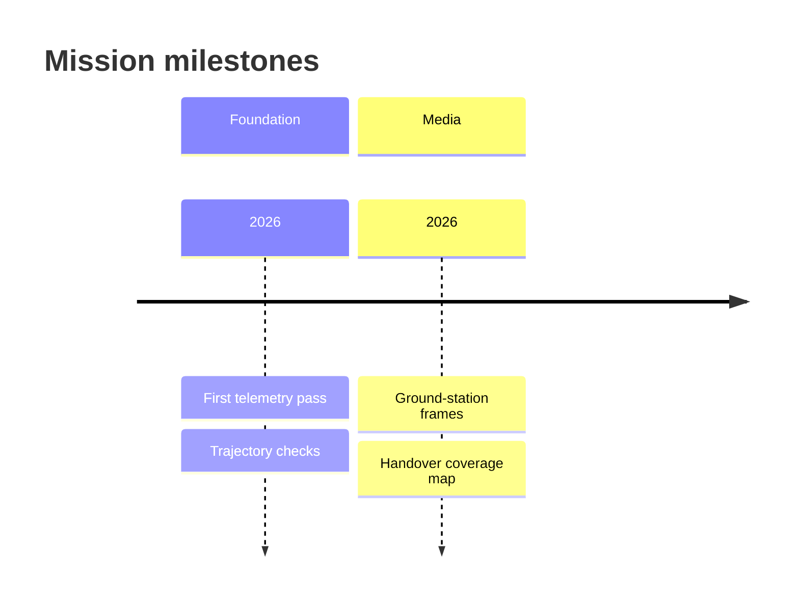

### A year in quarters

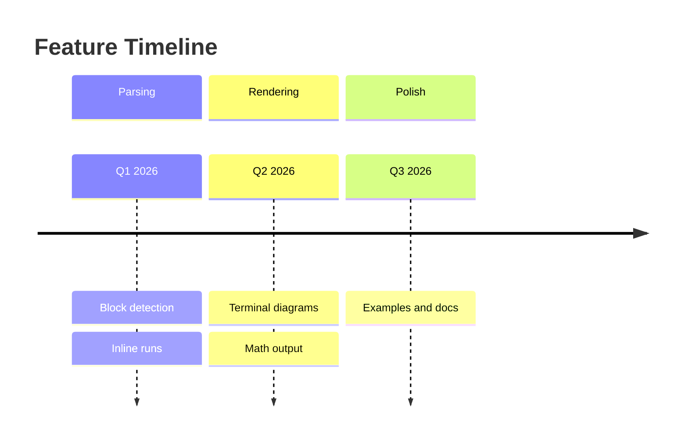

## Release history

How the branches came together:

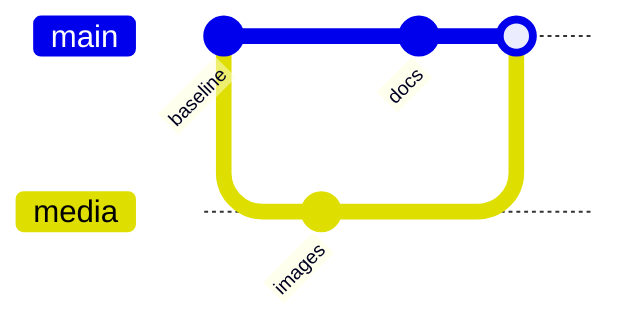

### A release branch


### Cherry-picking a commit

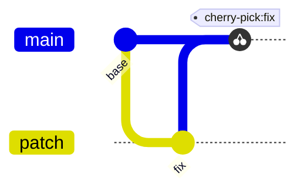

## Class diagrams

The first class diagrams use generic software and domain examples to keep the
relationship syntax easy to compare; the larger mission-oriented stress set is
in `merman-ext.md`.

### Shapes and interfaces

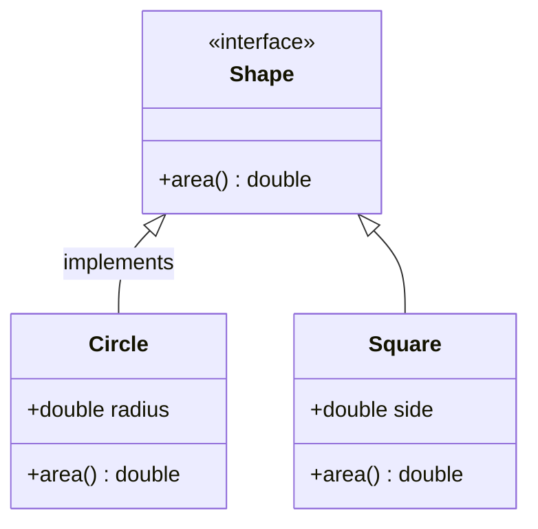

### An order and its parts

```mermaid
classDiagram
  class Order {
    +String id
    +total() double
  }
  class Customer {
    +String name
  }
  class LineItem {
    +int quantity
  }
  Order --> Customer : places
  Order *-- LineItem : contains
```

### The renderer itself

```mermaid
classDiagram
  direction LR
  class Renderer {
    <<service>>
    +render(input) void
  }
  class Parser {
    +parse(source) Document
  }
  class Document {
    +String title
  }
  Renderer ..> Parser : uses
  Parser ..> Document : builds
```

### A wallet and its payments

```mermaid
classDiagram
  direction BT
  class Wallet {
    +String owner
  }
  class Payment {
    <<abstract>>
    +amount() double
  }
  class Card {
    +String last4
  }
  class Cash {
    +double tendered
  }
  Wallet "1" o-- "0..*" Payment : holds
  Payment <|-- Card
  Payment <|-- Cash
```

### A store and its collaborators

```mermaid
classDiagram
  class Notifier {
    <<interface>>
    +send(message) void
  }
  class Store {
    +save(key, value) void
  }
  class Logger {
    +log(line) void
  }
  Notifier <|.. Store : implements
  Store -- Logger : uses
```

### A vehicle hierarchy

Six levels of inheritance, from the entity every record has down to the
person who signs it off:

```mermaid
classDiagram
  direction TB
  class Entity {
    +int id
    +touch() void
  }
  class Auditable {
    <<abstract>>
    +String actor
    +audit() void
  }
  class Party {
    +String name
    +rename(value) void
  }
  class Person {
    +Date born
  }
  class Employee {
    +String title
    +promote() void
  }
  class Manager {
    +int reports
    +approve(task) void
  }
  Entity <|-- Auditable
  Auditable <|-- Party
  Party <|-- Person
  Person <|-- Employee
  Employee <|-- Manager
  Person --> Entity : identifies
  Party o-- Entity : groups
```

### An expression fan-out

One abstract node and eight concrete ones:

```mermaid
classDiagram
  class Expr {
    <<abstract>>
    +String label
    +eval() double
  }
  class Add {
    +eval() double
  }
  class Sub {
    +eval() double
  }
  class Mul {
    +eval() double
  }
  class Div {
    +eval() double
  }
  class Pow {
    +eval() double
  }
  class Mod {
    +eval() double
  }
  class Neg {
    +eval() double
  }
  class Abs {
    +eval() double
  }
  Expr <|-- Add
  Expr <|-- Sub
  Expr <|-- Mul
  Expr <|-- Div
  Expr <|-- Pow
  Expr <|-- Mod
  Expr <|-- Neg
  Expr <|-- Abs
```

### Every relationship kind

Inheritance, composition, aggregation, dependency, realisation and a plain
link, all in one model:

```mermaid
classDiagram
  class Base {
    +int id
  }
  class Derived {
    +String extra
  }
  class Contract {
    <<interface>>
    +run() void
  }
  class Engine {
    +start() void
  }
  class Wheel {
    +int size
  }
  class Fleet {
    +String name
  }
  class Report {
    +String path
  }
  class Api {
    +get() Response
  }
  Base <|-- Derived : inherits
  Derived *-- Engine : owns
  Fleet o-- Wheel : holds
  Api --> Report : returns
  Api ..> Engine : uses
  Contract <|.. Derived : realizes
  Wheel -- Engine : links
```

### Diamond inheritance

Two branches that meet again:

```mermaid
classDiagram
  class Device {
    +String serial
    +power() void
  }
  class Networked {
    +String address
    +send() void
  }
  class Powered {
    +int watts
    +draw() int
  }
  class Router {
    +route() void
  }
  class Firewall {
    +filter() bool
  }
  class Gateway {
    +forward() void
  }
  class Cluster {
    +String region
  }
  Device <|-- Networked
  Device <|-- Powered
  Networked <|-- Router
  Powered <|-- Firewall
  Router <|-- Gateway
  Firewall <|-- Gateway
  Cluster o-- Gateway : hosts
  Cluster o-- Router : hosts
```

### A composition tree

Everything a document owns, down to the footnote:

```mermaid
classDiagram
  class Document {
    +String title
  }
  class Chapter {
    +int order
  }
  class Section {
    +String heading
  }
  class Paragraph {
    +String text
  }
  class Figure {
    +String caption
  }
  class Table {
    +int rows
  }
  class Footnote {
    +String note
  }
  Document *-- Chapter : contains
  Chapter *-- Section : contains
  Section *-- Paragraph : contains
  Section *-- Figure : contains
  Section *-- Table : contains
  Paragraph *-- Footnote : cites
  Figure --> Footnote : references
```

### Bidirectional associations

Both ends of the link are drawn:

```mermaid
classDiagram
  class User {
    +String email
  }
  class Team {
    +String name
  }
  class Project {
    +String title
  }
  class Ticket {
    +int number
  }
  class Comment {
    +String body
  }
  User --> Team : joins
  Team --> User : has
  User --> Project : owns
  Project --> User : contacts
  Project --> Ticket : tracks
  Ticket --> Project : belongs
  Ticket --> Comment : holds
  Comment --> Ticket : replies
  User <-- Comment : authors
```

### Self loops and cycles

A stage that feeds back into itself, and a step that refers to the next one:

```mermaid
classDiagram
  class Step {
    +String name
    +next() Step
  }
  class Pipeline {
    +run() void
  }
  class StageA {
    +int a
  }
  class StageB {
    +int b
  }
  class StageC {
    +int c
  }
  Pipeline *-- StageA
  StageA --> StageB
  StageB --> StageC
  StageC --> StageA
  Step --> Step : recurses
  Pipeline --> Step : schedules
  StageB ..> Pipeline : reports
```

### Stereotypes

Every stereotype the vocabulary knows:

```mermaid
classDiagram
  class Shape {
    <<interface>>
    +area() double
  }
  class Circle {
    <<class>>
    +double radius
  }
  class Color {
    <<enumeration>>
    +RED
    +GREEN
    +BLUE
  }
  class Renderer {
    <<service>>
    +draw() void
  }
  class ShapeFactory {
    <<abstract>>
    +create() Shape
  }
  class Registry {
    <<singleton>>
    +instance() Registry
  }
  Shape <|-- Circle
  ShapeFactory ..> Shape : builds
  Renderer --> Shape : paints
  Circle --> Color : uses
  Registry o-- ShapeFactory : tracks
```

### Quoted and special names

Names with spaces, dots, underscores and tildes:

```mermaid
classDiagram
  class "Order Service" {
    +place() void
  }
  class "Order Repository" {
    +save() void
  }
  class order_events {
    +String kind
  }
  class "order.line" {
    +int qty
  }
  class audit~v2 {
    +String actor
  }
  "Order Service" --> "Order Repository" : writes
  "Order Repository" --> order_events : emits
  order_events --> "order.line" : expands
  "order.line" --> audit~v2 : records
  audit~v2 --> "Order Service" : notifies
```

### Accessibility and comments

An accessible title and description, and comments in the source:

```mermaid
classDiagram
  accTitle: Commerce model
  accDescr: Orders, items and payments
  %% domain core
  class Order {
    +String code
    +total() double
  }
  class Item {
    +String sku
    +int qty
  }
  class Payment {
    +double value
    +capture() void
  }
  class Customer {
    +String name
  }
  class Address {
    +String zip
  }
  class Shipment {
    +String tracking
  }
  %% relationships
  Customer "1" --> "0..*" Order : places
  Order "1" *-- "1..*" Item : contains
  Order "1" --> "1" Payment : settles
  Order "1" --> "0..1" Shipment : ships
  Customer "1" o-- "0..1" Address : bills
  Item "0..*" --> "1" Payment : billed
```

### A class note

A note attached to a class appears in its box:

```mermaid
classDiagram
  class Animal {
    +String name
  }
  note for Animal "Not supported"
```
