# Merman Extension Stress Suite

Ninety-five large Mermaid fixtures for the vendored Merman renderer. The suite
is split into the class diagram stress cases and the edge cases for the other
six families. Scroll to compare; `c` opens the settings panel and `q` confirms
exit.

## Part I: Class diagram stress suite

Thirty-five `classDiagram` fixtures covering hierarchy, fan-out, directions,
routing, multiplicities, labels and notes.

## 1. Deep single-inheritance chain

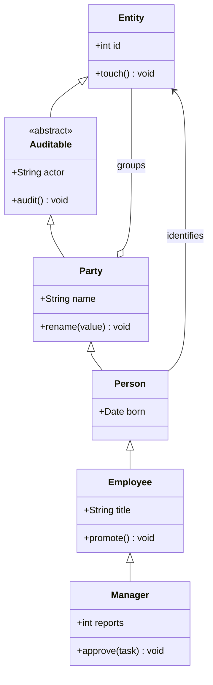

## 2. Wide fan-out

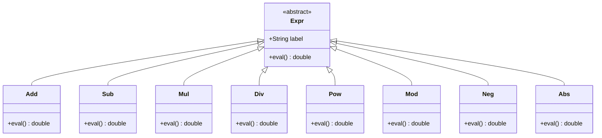

## 3. Every relationship kind

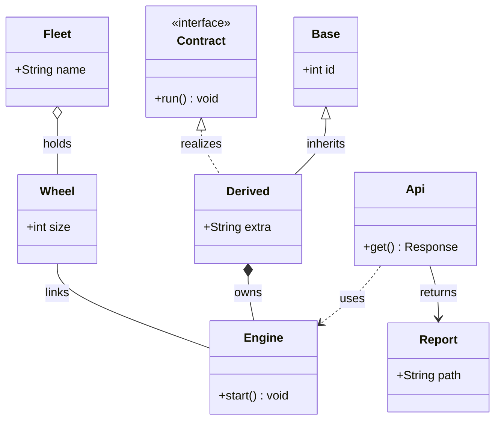

## 4. Diamond inheritance

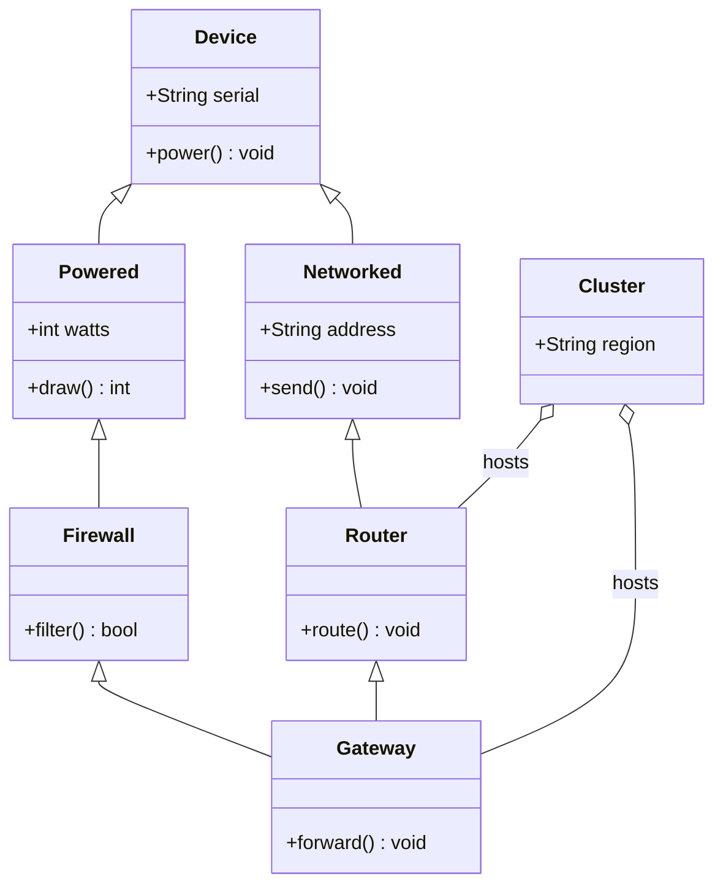

## 5. Composition tree

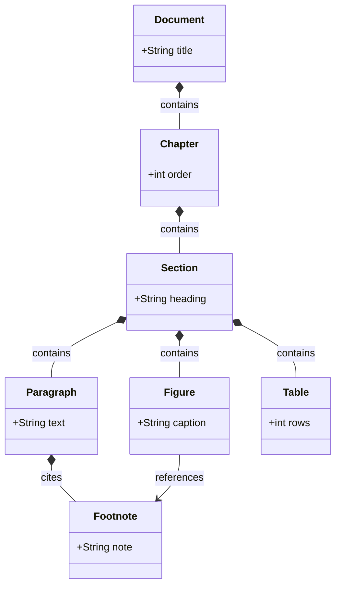

## 6. Aggregation network

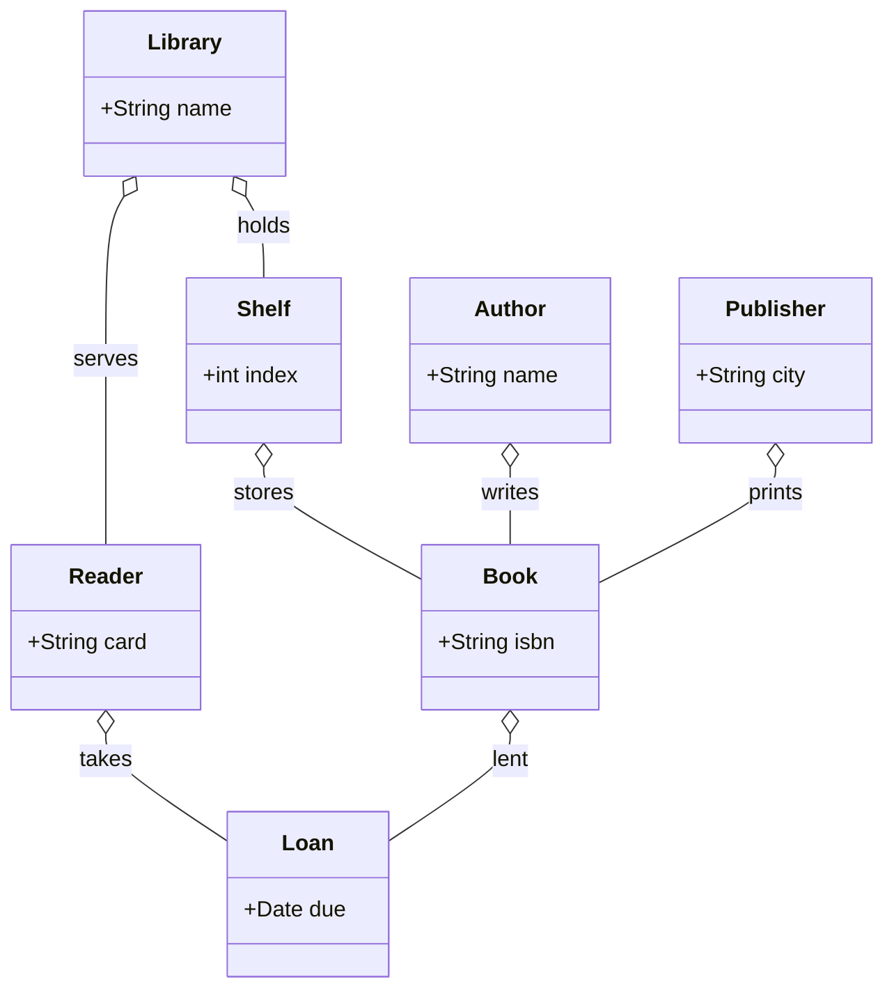

## 7. Layered architecture with long edges

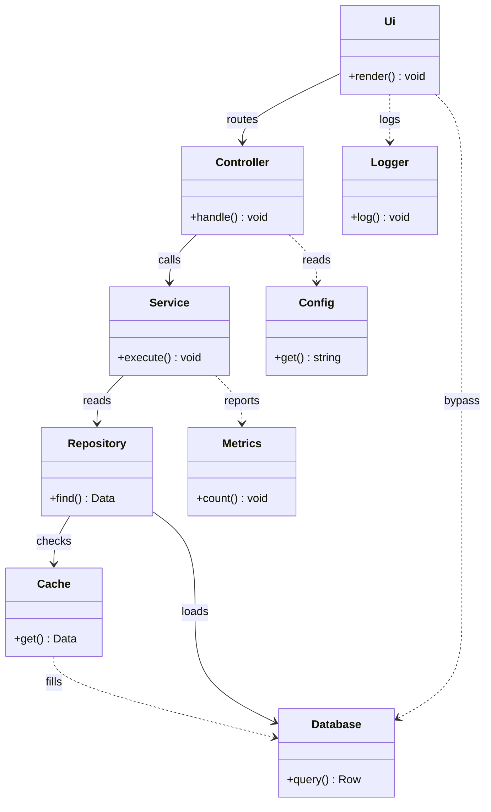

## 8. Dense mesh

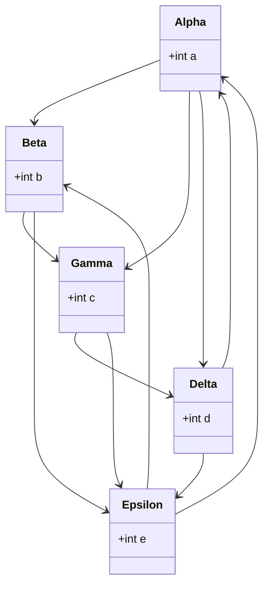

## 9. Direction LR

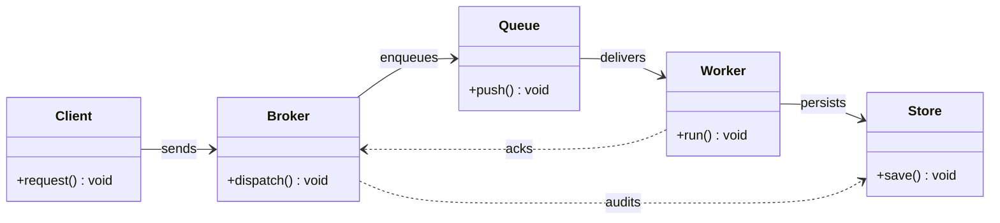

## 10. Direction RL

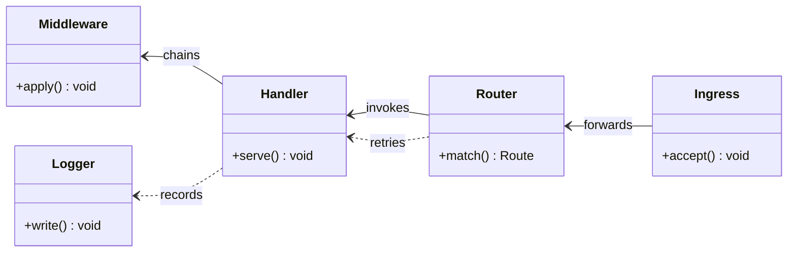

## 11. Direction BT

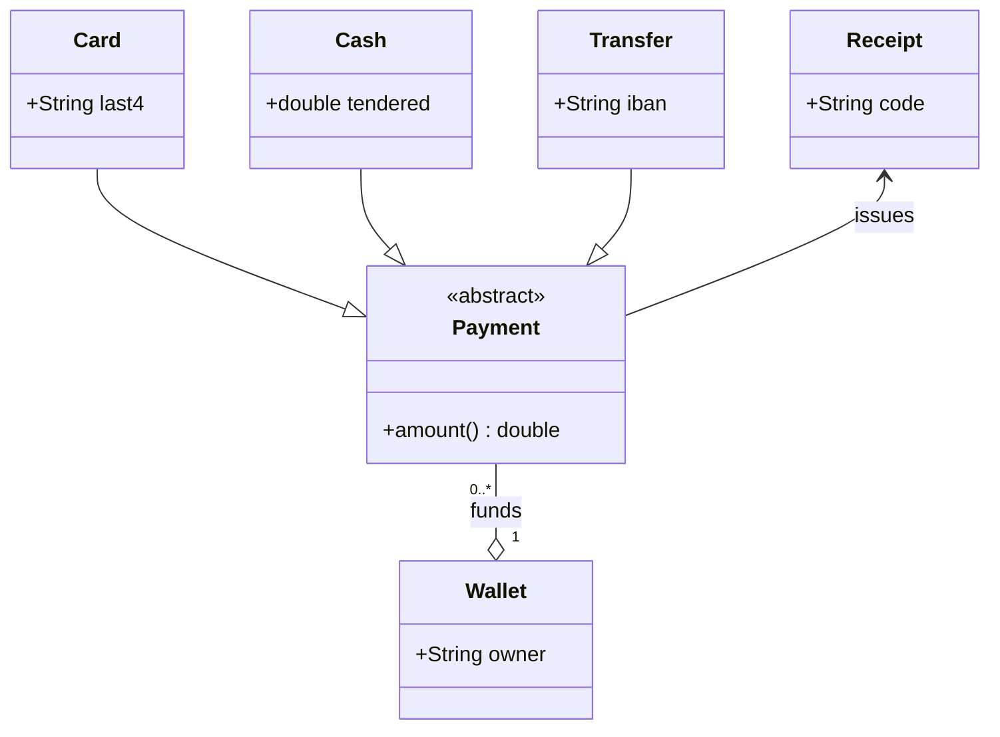

## 12. Bidirectional associations

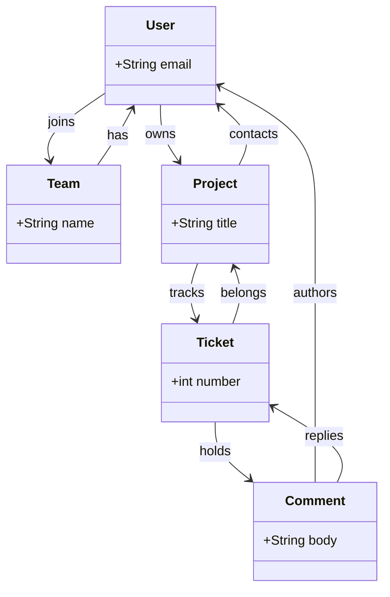

## 13. Self loops and cycles

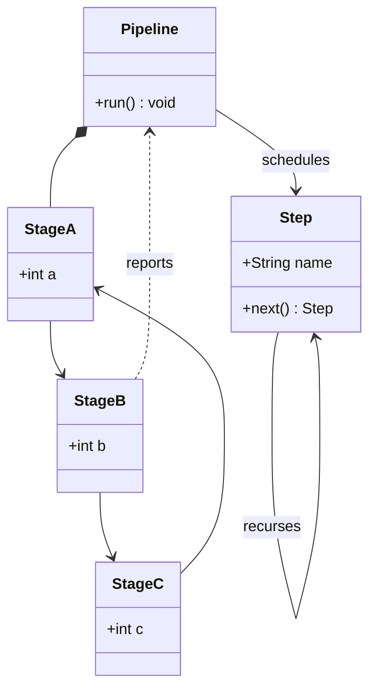

## 14. Disconnected clusters

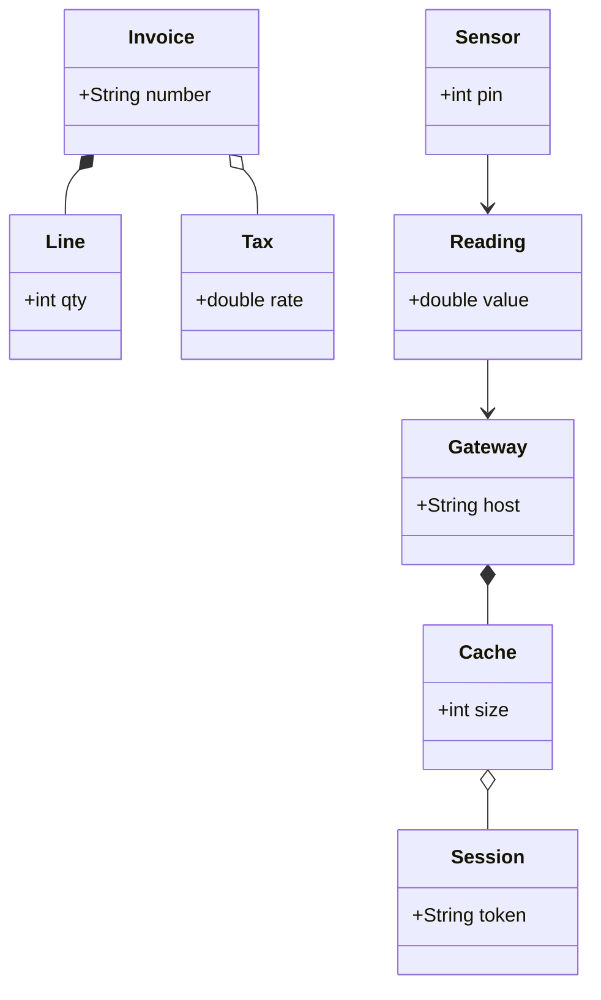

## 15. Corridor routing stress

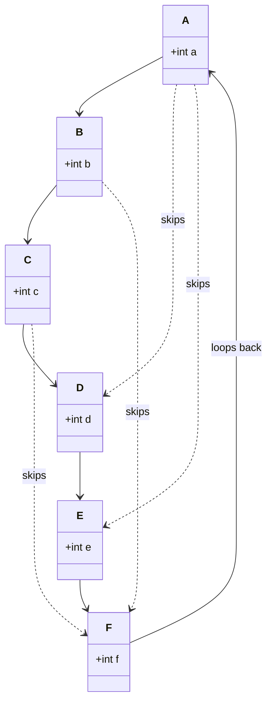

## 16. Heavy labels and multiplicities

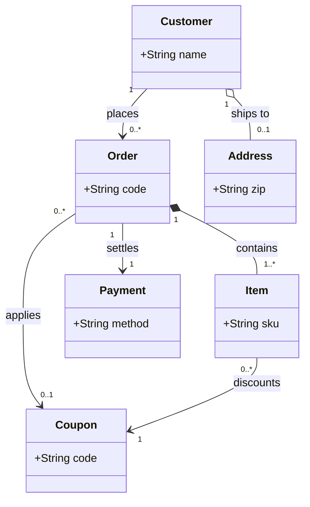

## 17. Stereotype variety

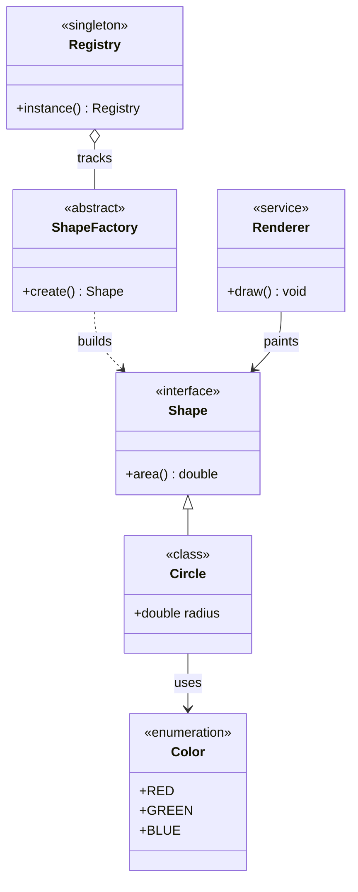

## 18. Generic and collection members

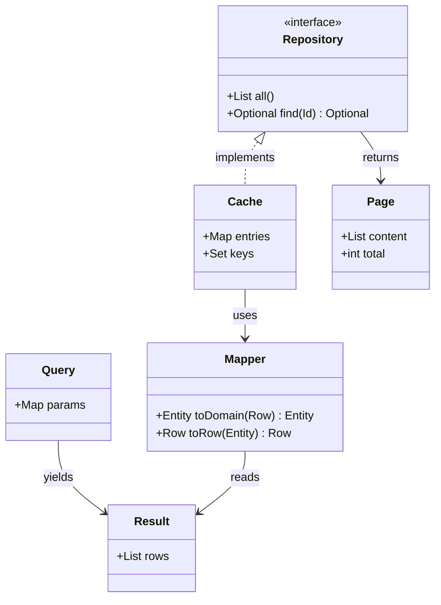

## 19. Quoted and special class names

```mermaid
classDiagram
  class "Order Service" {
    +place() void
  }
  class "Order Repository" {
    +save() void
  }
  class order_events {
    +String kind
  }
  class "order.line" {
    +int qty
  }
  class audit~v2 {
    +String actor
  }
  "Order Service" --> "Order Repository" : writes
  "Order Repository" --> order_events : emits
  order_events --> "order.line" : expands
  "order.line" --> audit~v2 : records
  audit~v2 --> "Order Service" : notifies
```

## 20. Cyclic dependencies

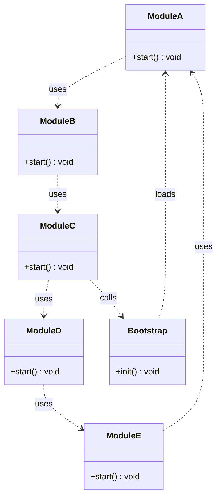

## 21. Layered with cross links

```mermaid
classDiagram
  direction TB
  class View {
    +paint() void
  }
  class ViewModel {
    +bind() void
  }
  class Model {
    +load() void
  }
  class Store {
    +get() Data
  }
  class Network {
    +fetch() Data
  }
  class Disk {
    +read() Data
  }
  class Telemetry {
    +emit() void
  }
  View --> ViewModel : observes
  ViewModel --> Model : reads
  Model --> Store : queries
  Store --> Network : refreshes
  Store --> Disk : caches
  View ..> Telemetry : tracks
  Network ..> Telemetry : tracks
  Disk ..> Telemetry : tracks
  ViewModel ..> Disk : warms
```

## 22. Branching tree

```mermaid
classDiagram
  class Root {
    +String id
  }
  class Left {
    +int l
  }
  class Middle {
    +int m
  }
  class Right {
    +int r
  }
  class LeftA {
    +int la
  }
  class LeftB {
    +int lb
  }
  class RightA {
    +int ra
  }
  class RightB {
    +int rb
  }
  class Leaf {
    +int v
  }
  Root *-- Left
  Root *-- Middle
  Root *-- Right
  Left *-- LeftA
  Left *-- LeftB
  Right *-- RightA
  Right *-- RightB
  LeftB --> Leaf : carries
  RightB --> Leaf : carries
  Middle --> Leaf : carries
```

## 23. Bipartite publishers and subscribers

```mermaid
classDiagram
  class PublisherA {
    +publish() void
  }
  class PublisherB {
    +publish() void
  }
  class PublisherC {
    +publish() void
  }
  class SubscriberX {
    +onEvent() void
  }
  class SubscriberY {
    +onEvent() void
  }
  class SubscriberZ {
    +onEvent() void
  }
  class Bus {
    +route() void
  }
  PublisherA --> Bus
  PublisherB --> Bus
  PublisherC --> Bus
  Bus --> SubscriberX
  Bus --> SubscriberY
  Bus --> SubscriberZ
  PublisherA ..> SubscriberZ : direct
  PublisherC ..> SubscriberX : direct
```

## 24. Chain with cross edges

```mermaid
classDiagram
  class L1 {
    +int v
  }
  class L2 {
    +int v
  }
  class L3 {
    +int v
  }
  class L4 {
    +int v
  }
  class L5 {
    +int v
  }
  class L6 {
    +int v
  }
  L1 --> L2
  L2 --> L3
  L3 --> L4
  L4 --> L5
  L5 --> L6
  L1 ..> L3 : skip
  L2 ..> L5 : skip
  L3 ..> L6 : skip
  L6 --> L1 : back
  L4 --> L2 : cross
```

## 25. Realization heavy

```mermaid
classDiagram
  class Serializable {
    <<interface>>
    +serialize() string
  }
  class Comparable {
    <<interface>>
    +compare(other) int
  }
  class Cloneable {
    <<interface>>
    +clone() Object
  }
  class Entity {
    +int id
  }
  class User {
    +String name
  }
  class Account {
    +double balance
  }
  Serializable <|.. Entity : implements
  Comparable <|.. User : implements
  Cloneable <|.. User : implements
  Serializable <|.. Account : implements
  Cloneable <|.. Account : implements
  Entity <|-- User
  Entity <|-- Account
```

## 26. Composition heavy

```mermaid
classDiagram
  class App {
    +run() void
  }
  class Window {
    +show() void
  }
  class Toolbar {
    +draw() void
  }
  class Canvas {
    +clear() void
  }
  class StatusBar {
    +set() void
  }
  class Button {
    +click() void
  }
  class Icon {
    +String path
  }
  App *-- Window
  Window *-- Toolbar
  Window *-- Canvas
  Window *-- StatusBar
  Toolbar *-- Button
  Button *-- Icon
  Canvas *-- Grid : draws
  Grid *-- Cell : holds
  class Grid {
    +int cols
  }
  class Cell {
    +String glyph
  }
```

## 27. Association heavy with multiplicities

```mermaid
classDiagram
  class Course {
    +String code
  }
  class Student {
    +String id
  }
  class Teacher {
    +String name
  }
  class Room {
    +String label
  }
  class Exam {
    +Date date
  }
  class Grade {
    +double value
  }
  Course "1" --> "0..*" Student : enrolls
  Teacher "1" --> "1..*" Course : teaches
  Course "1" --> "0..1" Room : uses
  Course "1" --> "1..*" Exam : schedules
  Student "1" --> "0..*" Exam : takes
  Exam "1" --> "0..*" Grade : yields
  Grade "0..*" --> "1" Student : belongs
```

## 28. Accessibility and comments

```mermaid
classDiagram
  accTitle: Commerce model
  accDescr: Orders, items and payments
  %% domain core
  class Order {
    +String code
    +total() double
  }
  class Item {
    +String sku
    +int qty
  }
  class Payment {
    +double value
    +capture() void
  }
  class Customer {
    +String name
  }
  class Address {
    +String zip
  }
  class Shipment {
    +String tracking
  }
  %% relationships
  Customer "1" --> "0..*" Order : places
  Order "1" *-- "1..*" Item : contains
  Order "1" --> "1" Payment : settles
  Order "1" --> "0..1" Shipment : ships
  Customer "1" o-- "0..1" Address : bills
  Item "0..*" --> "1" Payment : billed
```

## 29. Very wide sibling rank

```mermaid
classDiagram
  class Hub {
    +route() void
  }
  class N1 {
    +int v
  }
  class N2 {
    +int v
  }
  class N3 {
    +int v
  }
  class N4 {
    +int v
  }
  class N5 {
    +int v
  }
  class N6 {
    +int v
  }
  class N7 {
    +int v
  }
  class N8 {
    +int v
  }
  class N9 {
    +int v
  }
  class N10 {
    +int v
  }
  Hub --> N1
  Hub --> N2
  Hub --> N3
  Hub --> N4
  Hub --> N5
  Hub --> N6
  Hub --> N7
  Hub --> N8
  Hub --> N9
  Hub --> N10
```

## 30. Very tall rank chain

```mermaid
classDiagram
  direction TB
  class R1 {
    +int v
  }
  class R2 {
    +int v
  }
  class R3 {
    +int v
  }
  class R4 {
    +int v
  }
  class R5 {
    +int v
  }
  class R6 {
    +int v
  }
  class R7 {
    +int v
  }
  class R8 {
    +int v
  }
  class Side1 {
    +int s
  }
  class Side2 {
    +int s
  }
  R1 --> R2
  R2 --> R3
  R3 --> R4
  R4 --> R5
  R5 --> R6
  R6 --> R7
  R7 --> R8
  Side1 --> R4
  Side2 --> R6
  R8 ..> Side1 : returns
```

## 31. Labelled classes

```mermaid
classDiagram
  class Account["Customer Account"] {
    +String number
    +balance() Money
  }
  class Ledger["Transaction Ledger"] {
    +record(entry) void
  }
  class Statement["Monthly Statement"] {
    +generate() Document
  }
  Account "1" --> "0..*" Ledger : posts
  Account "1" --> "0..*" Statement : receives
  Ledger --> Account : balances
```

## 32. Attached notes

```mermaid
classDiagram
  class Gateway {
    +forward(request) Response
  }
  class Cache {
    +get(key) Value
  }
  note for Gateway "Validates every request before routing."
  note for Gateway "Retries idempotent calls once."
  note for Cache "Entries expire after five minutes."
  Gateway --> Cache : reads
```

## 33. Labels, stereotypes and cardinalities

```mermaid
classDiagram
  class Api["Public API"] {
    <<interface>>
    +handle() Response
  }
  class Router["Request Router"] {
    <<service>>
    +dispatch() void
  }
  class Store["Entity Store"] {
    <<singleton>>
    +load(id) Entity
  }
  class Audit["Audit Log"] {
    <<enumeration>>
    +APPEND
    +READ
  }
  Api "1" <|.. Router : implements
  Router "1" --> "0..*" Store : queries
  Router ..> Audit : records
```

## 34. Long labels and a wide fan-out

```mermaid
classDiagram
  direction LR
  class Coordinator["Request Coordinator"] {
    +route() void
  }
  class Parser["Payload Parser"]
  class Validator["Schema Validator"]
  class Authorizer["Policy Authorizer"]
  class Recorder["Telemetry Recorder"]
  class Renderer["Response Renderer"]
  class Archiver["Cold Storage Archiver"]
  Coordinator --> Parser : parses
  Coordinator --> Validator : validates
  Coordinator --> Authorizer : authorizes
  Coordinator --> Recorder : records
  Coordinator --> Renderer : renders
  Coordinator --> Archiver : archives
  Parser ..> Validator : normalizes
  Validator ..> Authorizer : approves
  Authorizer ..> Renderer : permits
```

## 35. Integrated commerce model

```mermaid
classDiagram
  direction TB
  class Customer["Customer"] {
    +String email
  }
  class Order["Sales Order"] {
    +String code
    +total() Money
  }
  class Item["Order Line"] {
    +int quantity
  }
  class Payment["Payment"] {
    <<abstract>>
    +capture() Receipt
  }
  class CardPayment["Card Payment"] {
    +String last4
  }
  class Invoice["Invoice"] {
    +String number
  }
  class Shipment["Shipment"] {
    +String tracking
  }
  class Warehouse["Warehouse"] {
    +String region
  }
  note for Order "Totals are recalculated after every line change."
  note for Payment "Card and cash payments share this contract."
  Customer "1" --> "0..*" Order : places
  Order "1" *-- "1..*" Item : contains
  Order "1" --> "0..1" Payment : settles
  Payment <|-- CardPayment
  Order "1" --> "1" Invoice : bills
  Order "1" --> "0..1" Shipment : ships
  Warehouse "1" o-- "0..*" Shipment : fulfills
```

## Part II: Non-class edge cases

Sixty diagrams for flowchart, sequence, state, Gantt, timeline and Git graph.
The first thirty cover the common grammar and the second thirty push nesting,
punctuation, long labels and less common link styles.

## 36. Every flowchart node shape

```mermaid
flowchart TD
  A[Box] --> B(Rounded)
  B --> C((Circle))
  C --> D{Decision}
  D --> E[(Database)]
  E --> F[[Subroutine]]
  F --> G{{Hexagon}}
  G --> H[/Parallelogram/]
```

## 37. Nested subgraphs and local directions

```mermaid
flowchart LR
  subgraph Outer[Outer group]
    direction TB
    A --> B
    subgraph Inner[Inner group]
      direction LR
      C --> D
    end
    B --> C
  end
  D --> E
```

## 38. Chained links and ampersand groups

```mermaid
flowchart LR
  A & B -->|shared| C & D
  C --> E
  D --> E
```

## 39. Semicolon statements, comments and ignored styles

```mermaid
flowchart TD; A[Start] --> B{Ready?}; B -->|yes| C[Done]; B -->|no| A %% retry
  classDef ignored fill:#f00;stroke:#111
  style C fill:#0f0
  linkStyle 0 stroke:#00f
```

## 40. Self loops, cycles and order-only links

```mermaid
flowchart LR
  A -->|retry| A
  A --> B
  B <--> C
  C --> A
  D --> D
  E --- F
  G --> G
  H --> H
  I
  J ~~~ K
```

## 41. Participant aliases, actors and boxes

```mermaid
sequenceDiagram
  box rgba(10,20,30,0.5) Backend
    participant A as API
    actor U as User
  end
  U->>A: Request
  A-->>U: Response
```

## 42. Notes and activation markers

```mermaid
sequenceDiagram
  participant A
  participant B
  A->>+B: Start
  note over A,B: Shared note
  note left of A: Left note
  note right of B: Right note
  B-->>-A: Done
```

## 43. Nested fragments

```mermaid
sequenceDiagram
  participant A
  participant B
  alt success
    A->>B: Try
    loop retry
      B-->>A: Busy
    end
  else failure
    B-->>A: Error
  end
```

## 44. Every sequence fragment kind

```mermaid
sequenceDiagram
  participant A
  participant B
  opt optional
    A->>B: Maybe
  end
  par first
    A->>B: One
  and second
    A->>B: Two
  end
  critical required
    A->>B: Must
  option fallback
    A->>B: Retry
  end
  break failure
    A->>B: Abort
  end
```

## 45. Message kinds, autonumber and self messages

```mermaid
sequenceDiagram
  autonumber 10 5
  participant A
  participant B
  A->>A: Think
  A->>B: Sync
  A-->>B: Reply
  A-xB: Cross
  A-)B: Async
  B-->>A: Final
```

## 46. Direction variants, self transitions and cycles

```mermaid
stateDiagram-v2
  direction RL
  [*] --> Idle
  Idle --> Running: start
  Running --> Running: tick
  Running --> Idle: stop
  Idle --> [*]
```

## 47. Choice, fork and join

```mermaid
stateDiagram-v2
  direction TB
  [*] --> Check
  state Check <<choice>>
  Check --> Accept: ok
  Check --> Reject: bad
  state Split <<fork>>
  state Join <<join>>
  Accept --> Split
  Split --> WorkA
  Split --> WorkB
  WorkA --> Join
  WorkB --> Join
  Join --> [*]
  Reject --> [*]
```

## 48. Nested composite states

```mermaid
stateDiagram-v2
  [*] --> Outer
  state Outer {
    [*] --> Inner
    state Inner {
      [*] --> Leaf
      Leaf --> [*]
    }
    Inner --> Done
  }
  Outer --> [*]
```

## 49. Inline and multiline notes

```mermaid
stateDiagram-v2
  [*] --> Draft
  note right of Draft: First line
  Draft --> Review
  note left of Review
    Needs two approvals.
    Then publish.
  end note
  Review --> Published
  Published --> [*]
```

## 50. Declarations, descriptions and aliases

```mermaid
stateDiagram-v2
  state "Waiting for input" as Waiting
  state Processing
  Processing: Runs the job
  [*] --> Waiting
  Waiting --> Processing: submit
  Processing --> Waiting: retry
  Processing --> [*]: finish: cleanup
```

## 51. Calendar dates, dependencies and task states

```mermaid
gantt
  title Calendar schedule
  dateFormat YYYY-MM-DD
  axisFormat %m-%d
  section Discovery
  Research :done, r1, 2026-01-01, 5d
  Review :active, r2, after r1, 3d
  section Delivery
  Build :crit, b1, after r2, 10d
  Ship :milestone, m1, after b1, 0d
```

## 52. Clock times and fixed tick intervals

```mermaid
gantt
  title Clock schedule
  dateFormat HH:mm
  axisFormat %H:%M
  tickInterval 15minutes
  section Morning
  Standup :s1, 09:00, 30m
  Focus :s2, after s1, 2h
  Review :s3, 11:00, 45m
```

## 53. Seconds and overlapping tasks

```mermaid
gantt
  title Seconds schedule
  dateFormat s
  axisFormat %S
  tickInterval 10s
  section Overlap
  Alpha :a, 0, 40
  Beta :b, 10, 30
  Gamma :c, 20, 50
```

## 54. Date-time values and multiple dependencies

```mermaid
gantt
  title Date-time schedule
  dateFormat YYYY-MM-DD HH:mm
  axisFormat %H:%M
  section Build
  Compile :c1, 2026-02-01 09:00, 2h
  Test :t1, after c1, 90m
  Package :p1, after c1, 30m
  Release :r1, after t1 p1, 15m
```

## 55. Accessibility, comments, vert and long labels

```mermaid
gantt
  title "Long label schedule"
  accTitle: Edge case
  accDescr: Tests accessibility metadata
  dateFormat YYYY-MM-DD
  section "A section with a long label"
  "A task with a much longer label than usual" :vert, t1, 2026-03-01, 4d
  Another task :t2, after t1, 2d %% comment
```

## 56. Multiple sections, periods and events

```mermaid
timeline
  title Release history
  section 2024
  2024-Q1 : Parser
  2024-Q2 : Renderer : Tables
  section 2025
  2025-Q1 : Mermaid : Math
  2025-Q2 : Images
```

## 57. Continuation lines and comments

```mermaid
timeline
  %% comment
  section Work
  2026 : Parser
       : Renderer
       : Tables
```

## 58. Quoted labels with punctuation

```mermaid
timeline
  title "A timeline: with punctuation"
  section "Phase: one"
  "2026: Q1" : "Parser: first pass" : "Renderer: layout"
```

## 59. Accessibility and horizontal direction

```mermaid
timeline LR
  title Long horizon
  accTitle: Long horizon
  accDescr: A long timeline
  section Discovery
  2020 : Research
  2021 : Prototype
  section Delivery
  2022 : Beta
  2023 : Release
```

## 60. Long events and multiple events per period

```mermaid
timeline
  title Operational history
  section Incidents
  2026-01 : Outage detected : Rollback started : Status page updated
  2026-02 : Postmortem published : Retry policy added
  section Improvements
  2026-03 : Queue isolation : Alert thresholds tuned : Runbook expanded
```

## 61. Branch, checkout, switch and merge

```mermaid
gitGraph
  commit id: "root"
  branch feature order: 1
  commit id: "f1"
  checkout main
  commit id: "m1"
  switch feature
  commit id: "f2"
  checkout main
  merge feature id: "merge-1" tag: "v1"
```

## 62. Commit types, tags and shorthand messages

```mermaid
gitGraph
  commit "Initial" id: "root" tag: "v0.1"
  commit id: "normal" type: NORMAL
  commit id: "highlight" type: HIGHLIGHT tag: "rc"
  commit id: "reverse" type: REVERSE
```

## 63. Multiple branches and cherry-pick

```mermaid
gitGraph
  commit id: "base"
  branch release order: 2
  commit id: "release-1" msg: "Cut release"
  checkout main
  commit id: "main-1"
  branch hotfix order: 1
  commit id: "fix"
  checkout main
  cherry-pick id: "fix"
  checkout release
  merge main id: "sync"
```

## 64. Direction, accessibility and multiline descriptions

```mermaid
gitGraph TB
  title History
  accTitle: History
  accDescr {
    A long description
    spanning lines
  }
  %% comment
  commit id: "a"
  branch side
  commit id: "b"
  checkout main
  commit id: "c"
```

## 65. Long labels, tags and branch names

```mermaid
gitGraph LR:
  commit id: "initial-commit" msg: "A very long commit message that should remain readable" tag: "v0.0.1"
  branch "feature/very-long-branch-name" order: 0
  commit id: "feature-commit" msg: "Implement the complete feature"
  checkout main
  commit id: "main-commit" msg: "Prepare the next release"
```

## Advanced flowchart edge cases

### 66. Quoted labels with punctuation

```mermaid
flowchart LR
  A["Start: parse"] -->|"yes: continue"| B["Render (fast)"]
  B --> C{"Check > 0?"}
  C -->|"no, retry"| A
```

### 67. Dotted, thick, invisible and bidirectional links

```mermaid
flowchart LR
  A --> B
  B -.-> C
  C ==> D
  D --- E
  E ~~~ F
  F <--> G
```

### 68. Long labels that wrap

```mermaid
flowchart TD
  A["A very long node label that should wrap across several lines without breaking the diagram"] --> B["Another long label for the destination node"]
  B --> C["Short"]
```

### 69. IDs with dots, dashes and underscores

```mermaid
flowchart LR
  start.node --> worker-one & worker_two & worker.three
  worker-one --> done.node
  worker_two --> done.node
  worker.three --> done.node
```

### 70. Multiple subgraphs across boundaries

```mermaid
flowchart BT
  subgraph Inputs
    direction LR
    A[Raw] --> B[Clean]
  end
  subgraph Processing
    direction TB
    C[Parse] --> D[Render]
  end
  subgraph Output
    direction LR
    E[Preview] --> F[Export]
  end
  B --> C
  D --> E
```

## Advanced sequence edge cases

### 71. Aliases with spaces and boxes

```mermaid
sequenceDiagram
  box rgb(20,40,60) Clients
    actor U as "End User"
    participant A as "API Gateway"
  end
  U->>A: "GET /items"
  A-->>U: "200 OK"
```

### 72. Deeply nested fragments

```mermaid
sequenceDiagram
  participant A
  participant B
  alt outer
    par left
      A->>B: one
    and right
      loop retry
        B-->>A: busy
      end
    end
  else fallback
    opt maybe
      A->>B: two
    end
  end
```

### 73. Explicit activation and self messages

```mermaid
sequenceDiagram
  participant A
  participant B
  A->>B: start
  activate B
  B->>B: work
  B-->>A: done
  deactivate B
  A->>+B: again
  B-->>-A: stop
```

### 74. Every arrow head style

```mermaid
sequenceDiagram
  autonumber
  participant A
  participant B
  A->B: sync open
  A-->B: sync dashed
  A->>B: solid arrow
  A-->>B: dashed arrow
  A-xB: solid cross
  A--xB: dashed cross
  A-)B: solid async
  A--)B: dashed async
```

### 75. Notes before participant declarations

```mermaid
sequenceDiagram
  note over A,B: Before declarations
  participant A
  participant B
  note right of B: After declarations
  A->>B: hello
```

## Advanced state edge cases

### 76. Fork and join inside a composite

```mermaid
stateDiagram-v2
  [*] --> Active
  state Active {
    [*] --> Split
    state Split <<fork>>
    Split --> A
    Split --> B
    A --> Join
    B --> Join
    state Join <<join>>
    Join --> [*]
  }
  Active --> [*]
```

### 77. Notes on composite and inner states

```mermaid
stateDiagram-v2
  [*] --> Outer
  state Outer {
    [*] --> Inner
    Inner --> [*]
  }
  note right of Outer: Composite note
  note left of Inner: Inner note
  Outer --> [*]
```

### 78. Choice with punctuation labels

```mermaid
stateDiagram-v2
  [*] --> Gate
  state Gate <<choice>>
  Gate --> Positive: x > 0
  Gate --> Zero: x == 0
  Gate --> Negative: x < 0
  Positive --> [*]
  Zero --> [*]
  Negative --> [*]
```

### 79. Long names and description punctuation

```mermaid
stateDiagram-v2
  state "A very long state name that should wrap" as Long
  Long: Description: with punctuation
  [*] --> Long
  Long --> [*]: finish: cleanup
```

### 80. BT direction with self transitions

```mermaid
stateDiagram-v2
  direction BT
  [*] --> Bottom
  Bottom --> Middle: up
  Middle --> Top: up
  Top --> Top: tick
  Top --> [*]
```

## Advanced Gantt edge cases

### 81. Second-precision dates

```mermaid
gantt
  title Second-precision schedule
  dateFormat YYYY-MM-DD HH:mm:ss
  axisFormat %H:%M:%S
  section Pipeline
  Ingest :i, 2026-04-01 09:00:00, 45s
  Transform :t, after i, 2m
  Load :l, after t, 90s
```

### 82. Day tick interval and chained dependencies

```mermaid
gantt
  title Day grid
  dateFormat YYYY-MM-DD
  axisFormat %m-%d
  tickInterval 1day
  section Chain
  A :a, 2026-04-10, 2d
  B :b, after a, 3d
  C :c, after b, 1d
```

### 83. Milestone chain and multiple dependencies

```mermaid
gantt
  title Milestone chain
  dateFormat YYYY-MM-DD
  axisFormat %m-%d
  section Release
  Build :b, 2026-05-01, 5d
  Test :t, after b, 3d
  Docs :d, after b, 4d
  Ship :milestone, m, after t d, 0d
  Announce :a, after m, 1d
```

### 84. Parallel tracks across sections

```mermaid
gantt
  title Parallel release train
  dateFormat YYYY-MM-DD
  axisFormat %m-%d
  section Alpha
  A1 :a1, 2026-06-01, 7d
  A2 :a2, after a1, 3d
  section Beta
  B1 :b1, 2026-06-01, 5d
  B2 :b2, after b1, 5d
  section Gamma
  G1 :g1, 2026-06-03, 9d
```

### 85. Quoted task labels and inline comments

```mermaid
gantt
  title "Quoted schedule"
  dateFormat YYYY-MM-DD
  axisFormat %m-%d
  section "Quoted section"
  "Task with punctuation!" :p, 2026-07-01, 3d %% inline
  "Second task" :q, after p, 2d
  "Final task" :r, after q, 1d
```

## Advanced timeline edge cases

### 86. Many sections and long periods

```mermaid
timeline
  title Program milestones
  section Alpha
  M1 : Kickoff
  M2 : Design : Prototype
  section Beta
  M3 : Build
  M4 : Test : Fix
  section Gamma
  M5 : Launch
```

### 87. Events without sections

```mermaid
timeline
  title Unsections
  2020 : Research
  2021 : Prototype
  2022 : Launch
```

### 88. TD direction and accessibility block

```mermaid
timeline TD
  title Vertical program
  accTitle: Vertical program
  accDescr {
    A description
    spanning lines
  }
  section Vertical
  2024 : One
  2025 : Two
```

### 89. Time-of-day periods

```mermaid
timeline
  title Daily schedule
  section Morning
  09:00 : Standup
  10:30 : Review
  section Afternoon
  14:00 : Build
  16:00 : Retro
```

### 90. Long events with continuation and comments

```mermaid
timeline
  %% leading comment
  section Long events
  2026 : A very long event label that should wrap without hiding the period
       : Another long event label for the same period
       : Final event
```

## Advanced Git graph edge cases

### 91. Many branches with explicit order

```mermaid
gitGraph
  commit id: "root"
  branch alpha order: 2
  commit id: "a1"
  branch beta order: 1
  commit id: "b1"
  checkout alpha
  commit id: "a2"
  checkout main
  commit id: "m1"
```

### 92. Sequential merges

```mermaid
gitGraph
  commit id: "root"
  branch one
  commit id: "one-1"
  checkout main
  branch two
  commit id: "two-1"
  checkout main
  merge one id: "merge-one"
  merge two id: "merge-two"
```

### 93. Cherry-pick with generated ID collision

```mermaid
gitGraph
  commit id: "commit-1"
  branch side
  commit id: "side-1"
  checkout main
  commit id: "main-1"
  cherry-pick id: "side-1"
```

### 94. Generated commit IDs and no messages

```mermaid
gitGraph
  commit
  commit
  branch feature
  commit
  checkout main
  commit
  merge feature
```

### 95. BT direction with tags and long messages

```mermaid
gitGraph BT
  title Bottom-up history
  commit id: "root" msg: "A long root commit message" tag: "v0.0.1"
  branch side
  commit id: "side" msg: "Side work" tag: "side-rc"
  checkout main
  commit id: "main" msg: "Main work" tag: "v0.0.2"
```
