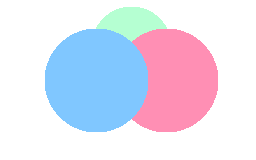

# Mixed Integration Document

This verifies that **Markdown**, $x^2$, tables, Mermaid, and local media do
not interfere with one another.

| Area | Result |
| --- | --- |
| Markdown | Native OpenTUI blocks |
| Formula | MiTeX and Typst image or source fallback |
| Media | Local terminal image |

$$
\int_0^\infty e^{-x^2}\,dx = \frac{\sqrt{\pi}}{2}
$$

