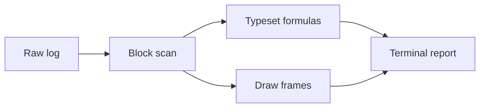

# Flight summary

A report mixes prose, formulas, tables, diagrams and frames without any of them
interfering with the others. Everything below comes from a single recorded
launch, KST-118.

| Phase | Time | Altitude | Outcome |
| --- | --- | --- | --- |
| Boost | T+0 – T+63 s | 0 – 41 km | Nominal |
| MECO | T+63 s | 41 km | Nominal |
| Stage 2 | T+69 s – T+512 s | 41 – 118 km | Nominal |
| Insertion | T+512 s | 118 km | Payload deployed |

The apogee follows from the vis-viva equation, $a_p = \frac{r_p}{1 - e}$, and
the flight ends with the payload deployed on schedule.

The vehicle budget is closed with the rocket equation:

$$
\Delta v = I_{sp} g_0 \ln\frac{m_0}{m_1}
$$

