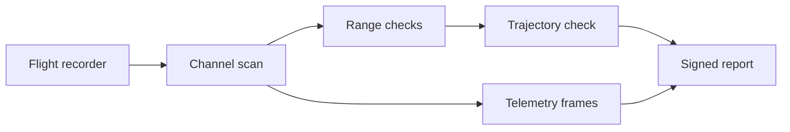

# Flight summary

At 02:17 UTC, the ground team closed the first review of KST-118. The report
below is intentionally mixed: a real handover note needs prose, tables,
equations, diagrams and image evidence in one place, without asking the reader
to open five different viewers.

## Mission timeline

| Phase | Time | Altitude | Outcome |
| --- | --- | --- | --- |
| Boost | T+0 – T+63 s | 0 – 41 km | Nominal |
| MECO (main-engine cutoff) | T+63 s | 41 km | Nominal |
| Stage 2 | T+69 s – T+512 s | 41 – 118 km | Nominal |
| Insertion | T+512 s | 118 km | Payload deployed |

The six-second gap between MECO and stage-two ignition is expected. It is the
quiet part of the sequence where the vehicle separates, settles, and lets the
guidance computer confirm its attitude before the next burn.

## Evidence path

The semi-major axis follows from the periapsis radius and eccentricity,
$a = \frac{r_p}{1 - e}$. The measured orbit remains within the review range, so
the flight director can sign the insertion event without mistaking a rounded
terminal value for a new measurement.

The vehicle budget is closed with the rocket equation:

$$
\Delta v = I_{sp} g_0 \ln\frac{m_0}{m_1}
$$

The summary frame illustrates the sensor handover. The transparent overlap is
a visual cue for shared coverage, not a rendering artefact.

## Operator conclusion

No channel crossed its hard range without an accompanying state transition. The
remaining work is administrative: archive the raw recorder, attach the source
formula output, and keep the signed summary beside the next launch window.
